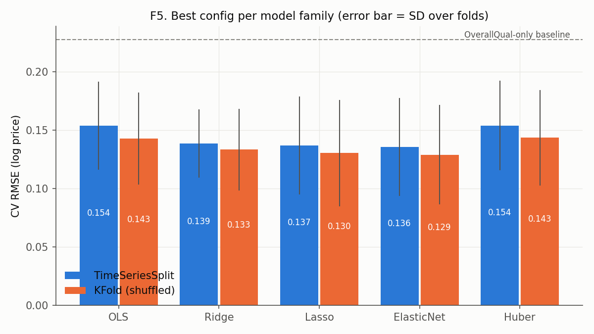
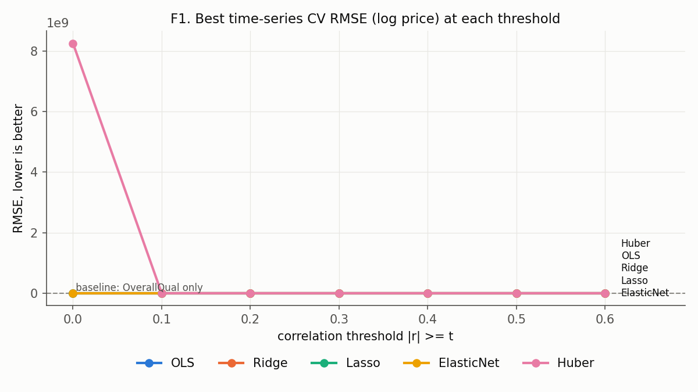
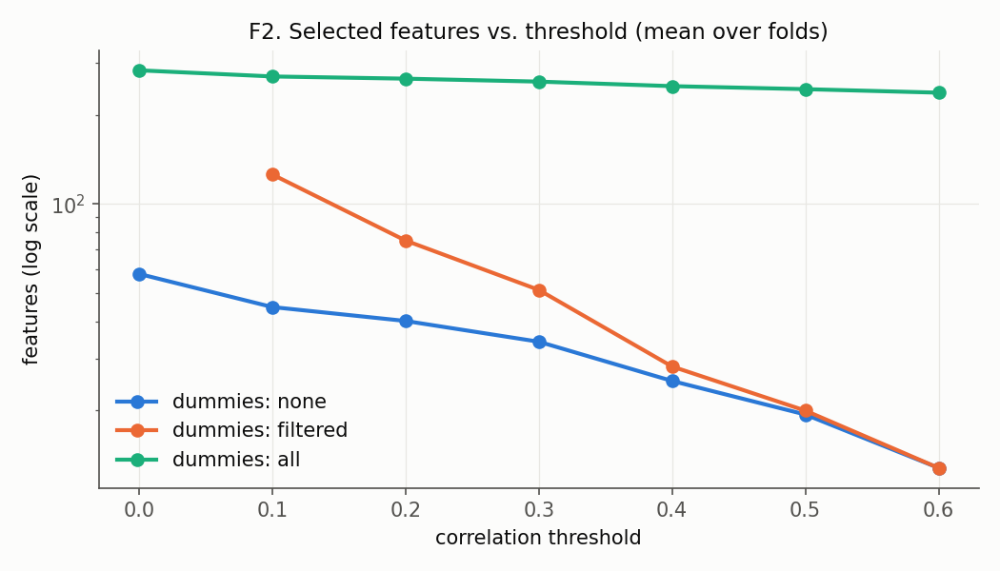
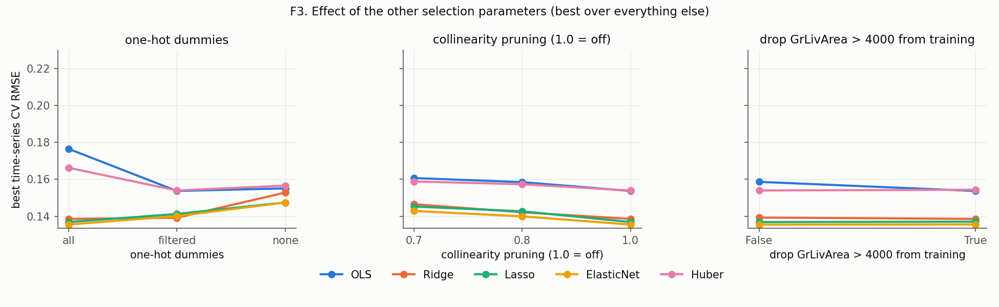
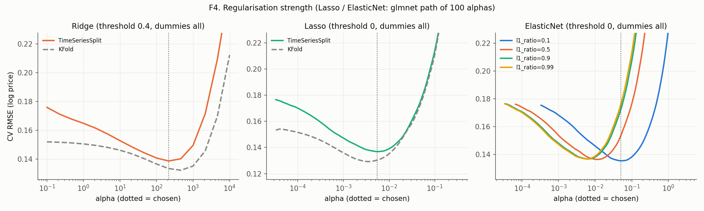

# Linear Regression with Correlation-Threshold Tuning (Ames House Prices)

Generated by `model/threshold_tuning.py`. Re-run it to regenerate every number and figure.

## 1. Setup

- **Target:** `log1p(SalePrice)` (from `process_dataset/one_hot_train.csv`). Metrics are in log units unless marked $.
  RMSE on log price is roughly the typical **relative** error (0.12 ≈ 12%) and is the official Kaggle metric.
- **Data:** 1460 training houses sold 2006-01 – 2010-07; 58 base features
  (numeric / ordinal / binary / cyclic / engineered) + 225 one-hot dummies.
- **Test labels:** `Dataset/sample_submission.csv` holds Kaggle placeholder prices, **not** true prices, so
  it is not used for evaluation. All scores below are cross-validated on train. `submission.csv` contains
  the best model's predictions for Kaggle upload.
- **Leakage control:** correlation-based selection, collinearity pruning, scaling and outlier removal are all
  computed on the training part of each fold only.
- **Time-series CV:** rows are sorted by sale date. `TimeSeriesSplit(5)` trains on the past and validates on the
  next period. Time-related features are `['GarageAge', 'HouseAge', 'RemodAge', 'YrSold', 'cos_MoSold', 'sin_MoSold']`. A config that selects any of them has
  `primary_cv = timeseries`; otherwise shuffled `KFold(5)` would be acceptable. **For a fair comparison every config
  is ranked by its time-series CV RMSE** (KFold is reported alongside).
  2108 of 2480 grid configs use time-related features.
- **Search size:** 2495 configurations × 2 CV schemes × 5 folds = 24,950 model fits.

## 2. Tunable parameters

| group | parameter | values tried | meaning |
|---|---|---|---|
| Feature selection | threshold | [0.0, 0.1, 0.2, 0.3, 0.4, 0.5, 0.6] | keep base feature if fold-train abs(Pearson r) with log price >= t |
| Feature selection | cat_mode | ['none', 'filtered', 'all'] | one-hot dummies: none / same threshold / all |
| Feature selection | prune | [1.0, 0.8] | greedy: drop feature whose abs(r) with a stronger kept feature > value (1.0 = off) |
| Training data | drop_outliers | [False, True] | remove GrLivArea>4000 & SalePrice<300k from training folds |
| OLS | - | - | LinearRegression |
| Ridge | alpha | [0.1, 1, 10, 30, 100, 300, 1000] | L2 penalty |
| Lasso | alpha | [0.0001, 0.0003, 0.001, 0.003, 0.01] | L1 penalty |
| ElasticNet | alpha x l1_ratio | [0.001, 0.003, 0.01, 0.03] x [0.2, 0.5, 0.8] | mixed L1/L2 |
| Huber | epsilon x alpha | [1.35, 2.0] x [0.0001, 1.0, 10.0] | robust loss; alpha = L2 penalty |
| CV | scheme | TimeSeriesSplit(5), KFold(5, shuffle, seed 0) | rows sorted by YrSold, MoSold |

All metric columns: `ts_` = TimeSeriesSplit, `kf_` = KFold; `*_rmse` = mean validation RMSE (log), `*_rmse_sd` = SD over folds,
`ts_mae_usd` = mean absolute error in dollars, `ts_train_rmse` = training-fold RMSE (overfitting check),
`ts_n_feats` = mean number of selected features.

## 3. Baselines

| tier | baseline | ts_rmse | ts_rmse_sd | kf_rmse | ts_mae_usd | ts_r2 |
|---|---|---|---|---|---|---|
| 1 Trivial | Predict mean | 0.4041 | 0.0070 | 0.3992 | 56,318 | -0.0048 |
| 2 Simple | OLS on OverallQual only | 0.2308 | 0.0136 | 0.2303 | 31,015 | 0.6712 |
| 3 Strong | HGB raw (lr=0.03, leaves=8, l2=1.0) | 0.1444 | 0.0206 | 0.1284 | 17,817 | 0.8693 |

## 4. Best configuration per model family

| model | params | threshold | cat_mode | prune | drop_outliers | ts_rmse | ts_rmse_sd | kf_rmse | ts_mae_usd | ts_r2 | ts_train_rmse | ts_n_feats | uses_time | primary_cv |
|---|---|---|---|---|---|---|---|---|---|---|---|---|---|---|
| OLS | - | 0.2 | filtered | 1 | True | 0.1515 | 0.0370 | 0.1493 | 18,158 | 0.8516 | 0.1021 | 73.6 | True | timeseries |
| Ridge | alpha=300 | 0 | all | 1 | True | 0.1384 | 0.0394 | 0.1369 | 16,085 | 0.8739 | 0.0854 | 283.0 | True | timeseries |
| Lasso | alpha=0.003 | 0 | all | 1 | True | 0.1377 | 0.0459 | 0.1348 | 16,305 | 0.8723 | 0.0803 | 283.0 | True | timeseries |
| ElasticNet | alpha=0.03, l1_ratio=0.2 | 0 | all | 1 | True | 0.1364 | 0.0463 | 0.1347 | 16,210 | 0.8743 | 0.0882 | 283.0 | True | timeseries |
| Huber | epsilon=1.35, alpha=10.0 | 0.1 | filtered | 1 | True | 0.1499 | 0.0415 | 0.1409 | 18,580 | 0.8528 | 0.0920 | 126.0 | True | timeseries |

**Overall best:** ElasticNet (alpha=0.03, l1_ratio=0.2), threshold = 0.0, dummies = all,
prune = 1.0, drop_outliers = True → time-series CV RMSE **0.1364 ± 0.0463**,
MAE ≈ **$16,210**, R² = 0.874 (vs. 0.4041 for predicting the mean).
The final model uses 283 features when refit on all training data.

## 5. Effect of the correlation threshold

Best time-series CV RMSE at each threshold (minimum over all other parameters):

| threshold | OLS | Ridge | Lasso | ElasticNet | Huber |
|---|---|---|---|---|---|
| 0 | 0.1676 | 0.1384 | 0.1377 | 0.1364 | 0.1513 |
| 0.1 | 0.1540 | 0.1409 | 0.1416 | 0.1401 | 0.1499 |
| 0.2 | 0.1515 | 0.1412 | 0.1419 | 0.1403 | 0.1531 |
| 0.3 | 0.1543 | 0.1413 | 0.1418 | 0.1403 | 0.1547 |
| 0.4 | 0.1558 | 0.1409 | 0.1400 | 0.1401 | 0.1544 |
| 0.5 | 0.1647 | 0.1446 | 0.1454 | 0.1445 | 0.1624 |
| 0.6 | 0.1666 | 0.1480 | 0.1471 | 0.1467 | 0.1639 |

Best threshold per family: OLS → 0.2, Ridge → 0.0, Lasso → 0.0, ElasticNet → 0.0, Huber → 0.1.

## 6. Other selection parameters

Best time-series CV RMSE for each value (minimum over everything else):

- **cat_mode:** all = 0.1364, filtered = 0.1410, none = 0.1479
- **prune:** 0.8 = 0.1425, 1.0 = 0.1364
- **drop_outliers:** False = 0.1415, True = 0.1364

## 7. Regularisation strength

## 8. Time-series vs. shuffled KFold

Difference (time-series − KFold RMSE) for the best config of each family:
OLS: +0.0023, Ridge: +0.0015, Lasso: +0.0029, ElasticNet: +0.0017, Huber: +0.0090.
A positive gap means shuffled KFold looks optimistic. Outliers are removed from training folds only, so the two
huge partial sales (Id 524, 1299) stay in validation fold [1] and dominate its error. Part of the gap is because the early time-series folds have
far less training data (the first fold trains on ~245 rows), not only because of
future information leaking into the training folds.

Per-fold errors of the best model:

| fold | val_period | n_feats | rmse | train_rmse | mae_usd | r2 |
|---|---|---|---|---|---|---|
| 0 | 2006-08..2007-07 | 283 | 0.1165 | 0.0716 | 14,387 | 0.9173 |
| 1 | 2007-07..2008-05 | 283 | 0.2171 | 0.0848 | 25,848 | 0.7053 |
| 2 | 2008-05..2009-03 | 283 | 0.0996 | 0.0917 | 12,297 | 0.9382 |
| 3 | 2009-03..2009-09 | 283 | 0.1263 | 0.0935 | 13,836 | 0.8988 |
| 4 | 2009-09..2010-07 | 283 | 0.1225 | 0.0995 | 14,680 | 0.9118 |

## 9. Error analysis (best model, time-series out-of-fold predictions, 1215 houses)

By price quintile (`bias` > 0 = over-predicts):

| price_band | mape | bias | n |
|---|---|---|---|
| Q1 cheapest | 13.23 | 8.84 | 243 |
| Q2 | 7.18 | 0.78 | 250 |
| Q3 | 10.43 | 3.39 | 236 |
| Q4 | 7.96 | 1.90 | 244 |
| Q5 priciest | 8.46 | -4.46 | 242 |

By sale condition:

| SaleCondition | mape | bias | n |
|---|---|---|---|
| Normal | 7.10 | 0.62 | 1014 |
| AdjLand | 8.68 | -8.68 | 3 |
| Alloca | 15.66 | 2.27 | 12 |
| Abnorml | 17.53 | 10.05 | 79 |
| Family | 18.74 | 14.76 | 13 |
| Partial | 25.73 | 9.72 | 94 |

Neighbourhoods (n ≥ 15), largest MAPE: Edwards 26.0%, IDOTRR 19.6%, ClearCr 11.6%, BrkSide 10.5%, OldTown 10.2%;
smallest: CollgCr 4.9%, Gilbert 5.7%, SawyerW 6.1%, Mitchel 6.7%, Timber 7.4%.

Ten largest errors:

| Id | Neighborhood | SaleCondition | GrLivArea | OverallQual | SalePrice | pred | err_pct |
|---|---|---|---|---|---|---|---|
| 1299 | Edwards | Partial | 5642 | 10 | 160000 | 1,681,146 | 950.7 |
| 524 | Edwards | Partial | 4676 | 10 | 184750 | 913,230 | 394.3 |
| 633 | NWAmes | Family | 1411 | 7 | 82500 | 182,115 | 120.7 |
| 917 | IDOTRR | Abnorml | 480 | 2 | 35311 | 76,579 | 116.9 |
| 31 | IDOTRR | Normal | 1317 | 4 | 40000 | 78,614 | 96.5 |
| 969 | OldTown | Abnorml | 968 | 3 | 37900 | 73,646 | 94.3 |
| 463 | Sawyer | Normal | 864 | 5 | 62383 | 117,574 | 88.5 |
| 411 | Edwards | Abnorml | 1276 | 5 | 60000 | 110,486 | 84.1 |
| 1325 | Somerst | Partial | 1795 | 8 | 147000 | 261,984 | 78.2 |
| 496 | IDOTRR | Abnorml | 720 | 4 | 34900 | 57,018 | 63.4 |

## 10. Coefficients of the final model

Features are standardised, so coefficient size is comparable: change in log price per +1 SD (≈ % change ×100).
Whiskers in F9 show the range across time-series folds; a whisker crossing 0 means the sign is unstable.

| feature | coef |
|---|---|
| Qual_x_Area | 0.0587 |
| TotalArea | 0.0555 |
| OverallQual | 0.0513 |
| GrLivArea | 0.0457 |
| HouseAge | -0.0366 |
| LotArea | 0.0353 |
| OverallCond | 0.0325 |
| BsmtFinSF1 | 0.0264 |
| MSZoning_C | -0.0260 |
| GarageCars | 0.0196 |
| TotalBaths | 0.0174 |
| GarageArea | 0.0154 |
| Neighborhood_Crawfor | 0.0152 |
| RemodAge | -0.0151 |
| KitchenQual | 0.0151 |
| MSZoning_RM | -0.0141 |
| SaleCondition_Abnorml | -0.0134 |
| SaleType_New | 0.0121 |
| HeatingQC | 0.0115 |
| TotalPorchArea | 0.0114 |

## 11. Top 15 configurations overall

| model | params | threshold | cat_mode | prune | drop_outliers | ts_rmse | ts_rmse_sd | kf_rmse | ts_mae_usd | ts_r2 | ts_train_rmse | ts_n_feats | uses_time | primary_cv |
|---|---|---|---|---|---|---|---|---|---|---|---|---|---|---|
| ElasticNet | alpha=0.03, l1_ratio=0.2 | 0 | all | 1 | True | 0.1364 | 0.0463 | 0.1347 | 16,210 | 0.8743 | 0.0882 | 283.0 | True | timeseries |
| ElasticNet | alpha=0.01, l1_ratio=0.5 | 0 | all | 1 | True | 0.1371 | 0.0460 | 0.1347 | 16,244 | 0.8734 | 0.0857 | 283.0 | True | timeseries |
| Lasso | alpha=0.003 | 0 | all | 1 | True | 0.1377 | 0.0459 | 0.1348 | 16,305 | 0.8723 | 0.0803 | 283.0 | True | timeseries |
| ElasticNet | alpha=0.003, l1_ratio=0.8 | 0 | all | 1 | True | 0.1379 | 0.0460 | 0.1351 | 16,340 | 0.8719 | 0.0783 | 283.0 | True | timeseries |
| ElasticNet | alpha=0.01, l1_ratio=0.2 | 0 | all | 1 | True | 0.1381 | 0.0462 | 0.1351 | 16,394 | 0.8715 | 0.0769 | 283.0 | True | timeseries |
| Ridge | alpha=300 | 0 | all | 1 | True | 0.1384 | 0.0394 | 0.1369 | 16,085 | 0.8739 | 0.0854 | 283.0 | True | timeseries |
| ElasticNet | alpha=0.01, l1_ratio=0.8 | 0 | all | 1 | True | 0.1384 | 0.0463 | 0.1369 | 16,536 | 0.8708 | 0.0922 | 283.0 | True | timeseries |
| ElasticNet | alpha=0.003, l1_ratio=0.5 | 0 | all | 1 | True | 0.1400 | 0.0459 | 0.1364 | 16,669 | 0.8685 | 0.0747 | 283.0 | True | timeseries |
| Lasso | alpha=0.01 | 0 | all | 1 | True | 0.1400 | 0.0465 | 0.1388 | 16,808 | 0.8681 | 0.0960 | 283.0 | True | timeseries |
| Lasso | alpha=0.003 | 0.4 | all | 1 | True | 0.1400 | 0.0382 | 0.1394 | 16,698 | 0.8716 | 0.0885 | 249.2 | True | timeseries |
| ElasticNet | alpha=0.03, l1_ratio=0.2 | 0.4 | all | 1 | True | 0.1401 | 0.0409 | 0.1399 | 16,665 | 0.8704 | 0.0960 | 249.2 | True | timeseries |
| ElasticNet | alpha=0.03, l1_ratio=0.2 | 0.1 | all | 1 | True | 0.1401 | 0.0459 | 0.1384 | 16,580 | 0.8681 | 0.0932 | 270.4 | True | timeseries |
| ElasticNet | alpha=0.01, l1_ratio=0.2 | 0.4 | all | 1 | True | 0.1402 | 0.0372 | 0.1393 | 16,753 | 0.8716 | 0.0858 | 249.2 | True | timeseries |
| ElasticNet | alpha=0.01, l1_ratio=0.5 | 0.4 | all | 1 | True | 0.1403 | 0.0404 | 0.1399 | 16,707 | 0.8703 | 0.0936 | 249.2 | True | timeseries |
| ElasticNet | alpha=0.03, l1_ratio=0.2 | 0.3 | all | 1 | True | 0.1403 | 0.0457 | 0.1388 | 16,646 | 0.8678 | 0.0934 | 259.8 | True | timeseries |

Full results: `results_all.csv` (one row per configuration) and `results_folds.csv` (one row per fold).

## 12. Notes and limitations

- Hyperparameters are chosen on the same CV that reports the score (no nested CV), so the best score is slightly optimistic.
- Pearson correlation only captures linear, one-feature-at-a-time relationships; dummies are judged by point-biserial r.
- The processed data was z-scored on all of train before this script; re-scaling inside each fold removes the
  effect on the models, but fill-NA and category cleaning were done globally.
- Price bands use quintiles of the actual price, so the bias by band partly reflects regression to the mean.
