# Linear Regression on Ames House Prices (time-split data)

Generated by `model/report.py` (`python model/run_all.py` reruns everything). Figures: `results/figures/`; tables as CSV in `results/`, as LaTeX (booktabs, ACL style) in `results/tables/` named by table code.

## 1. Data and setup

- **Data:** the team's pre-processed files `process_dataset/one_hot_train.csv` / `one_hot_test.csv`, split **chronologically** (README §0). The test set is used once, after every modelling choice is made.
- **Target:** log1p(SalePrice); dollar metrics use expm1 of the prediction.
- **Log transform decided inside every fit:** the team's rule log1p-transforms a numeric feature when its skewness exceeds 0.75. The pre-processing chooses the list once on the whole training set and reuses it for test (`mapping/skewed_features.json`), so the choice has seen every future CV validation fold. Here the raw values of the 39 skew-checked columns are rebuilt from `Dataset/train.csv` with the team's formulas, and the same rule is re-applied **on the training rows of each fit only** (each CV fold, each bootstrap resample, the final model); the chosen transform is then applied unchanged to that fit's validation or test rows. On the full training set this reproduces the team's log-transformed columns exactly.

| Split | Period | Houses | Median price ($k) |
|:---|---:|---:|---:|
| Train | 2006-01..2009-07 | 1168 | 165.0 |
| Test | 2009-07..2010-07 | 292 | 157.9 |

*Table 1: Chronological train / test split.*

| Feature group | Count | Examples |
|:---|---:|:---|
| Original (non-dummy) | 48 | GrLivArea, OverallQual, YearBuilt |
| One-hot dummies | 225 | Neighborhood_…, SaleCondition_… |
| Engineered | 17 | TotalArea, HouseAge, Qual_x_Area |
| Greedy list (models/) | 96 | 91 original + 5 engineered |
| Total | 290 |  |

*Table 2: Feature groups after pre-processing.*

| Fold | Train rows | Validation rows | Validation period |
|:---|---:|---:|---:|
| 1 | 198 | 194 | 2006-07..2007-05 |
| 2 | 392 | 194 | 2007-05..2007-10 |
| 3 | 586 | 194 | 2007-10..2008-06 |
| 4 | 780 | 194 | 2008-06..2009-03 |
| 5 | 974 | 194 | 2009-03..2009-07 |

*Table 3: Time-series cross-validation folds (expanding window) inside the training set.*

### 1.1 Scaling inside cross-validation

Every data-dependent step is **decided on the training part of each fold only and applied unchanged to the validation part** (and, for the final model, to the test set): the outlier rule, the log1p choice, the |r| ranking for feature selection, and the scaler. The validation fold stands in for future data. Standardising it with its own mean and SD would use information unavailable at prediction time (Kaufman et al. 2012; Hastie et al. 2009 §7.10.2), and would give the same house different z-scores in different sets. Re-standardising inside each fold also puts the ordinal, binary and time columns (left unscaled by pre-processing) on the same scale, which penalised models require (Tibshirani 1996).

## 2. Exploratory feature analysis (§4)

All statistics use the training set only; the test set is touched only to measure train → test drift.

- **Target:** raw SalePrice is right-skewed (skew 1.92); log1p reduces this to 0.16 (E1), so the model predicts log price.
- **Association:** by Cohen's |r| bands, 24 features are large (≥ 0.5), 31 medium, 75 small and 160 negligible (E2, T4).
- **Shape:** the strongest features relate to log price roughly linearly (E3).
- **Redundancy:** area, quality, garage and age features form tightly correlated blocks (E4).
- **Location:** median price differs strongly by neighbourhood (E6).
- **Drift:** 17 of 65 non-dummy features shift by |SMD| > 0.1 between the periods; apart from YrSold (by construction) the shifts are modest (E5, T5).

**How the evidence shaped the features.**
- **Keep:** strong and medium features, and the location dummies (E2, E6).
- **Transform:** the target and skewed areas to log scale (E1, E3); calendar years to ages; month to sin/cos (seasonality has no "December > January" order).
- **Combine:** correlated parts into aggregates (TotalArea, TotalBaths) and add a quality × size interaction (E4, E2).
- **Drop:** weak features are dropped by a correlation threshold tuned by CV (§5.2) rather than by hand; redundancy is handled by the penalty rather than by deleting features.

The hypotheses below are tested in §7.2 and §8.1 (T19).

| Feature | Type | r | Effect size (Cohen) |
|:---|:---|---:|:---|
| Qual_x_Area | engineered | +0.848 | large |
| OverallQual | original | +0.818 | large |
| TotalArea | engineered | +0.806 | large |
| GrLivArea | original | +0.746 | large |
| GarageCars | original | +0.682 | large |
| TotalBaths | engineered | +0.668 | large |
| ExterQual | original | +0.664 | large |
| KitchenQual | original | +0.659 | large |
| GarageArea | original | +0.651 | large |
| TotalQualCond | engineered | +0.647 | large |
| BsmtQual | original | +0.617 | large |
| 1stFlrSF | original | +0.604 | large |

*Table 4: Twelve features most correlated with log price on the training set (Pearson r; Cohen's bands 0.1 / 0.3 / 0.5).*

| Feature | SMD (test − train) | KS p |
|:---|---:|---:|
| YrSold | +2.67 | <0.001 |
| cos_MoSold | +0.30 | <0.001 |
| MiscVal | +0.18 | 0.816 |
| HouseAge | +0.15 | 0.004 |
| HeatingQC | -0.14 | 0.077 |
| RemodAge | +0.14 | 0.014 |
| GarageAge | +0.14 | 0.009 |
| BsmtFullBath | +0.13 | 0.154 |

*Table 5: Largest train → test shifts among non-dummy features (standardised mean difference; Kolmogorov-Smirnov p).*

| ID | Hypothesis | Evidence (training set) | Tested in |
|:---|:---|:---|:---|
| H1 | Size: larger houses cost more; log price is roughly linear in log size | r(TotalArea) = +0.81, r(GrLivArea) = +0.75; linear trend in E3 | §8.1 (β > 0) |
| H2 | Quality: overall quality is among the strongest drivers of price | r(OverallQual) = +0.82, the strongest original feature (E2) | §8.1 (β > 0) |
| H3 | Age: older houses are cheaper even at the same size and quality | r(HouseAge) = -0.57, but age correlates with quality (E4) | §8.1 (β < 0) |
| H4 | Location: neighbourhood and zoning shift the price level | median price ranges $94k–$318k across neighbourhoods (E6) | §8.1 (dummies, GVIF) |
| H5 | Luxury premium: quality matters more in bigger houses (quality × size) | r(Qual_x_Area) = +0.85, the highest of all features (E2) | §8.1 (β > 0) |
| H6 | Engineered features add predictive value beyond the raw columns | 4 of the 10 strongest features are engineered (E2) | §7.2 (Set B vs A) |
| H7 | Collinear blocks make a penalised model better than plain OLS | area, quality, garage and age features form correlated blocks (E4) | §5.2 / §7.1 (CV, OLS vs penalised) |

*Table 6: Hypotheses derived from the exploratory analysis and where they are tested.*

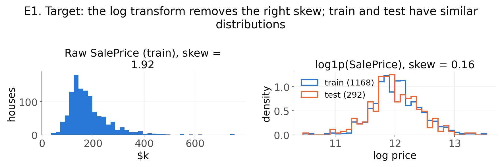
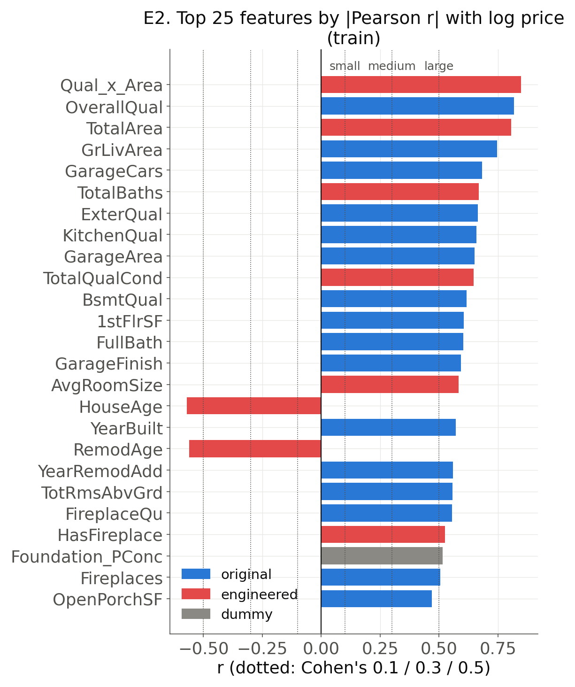
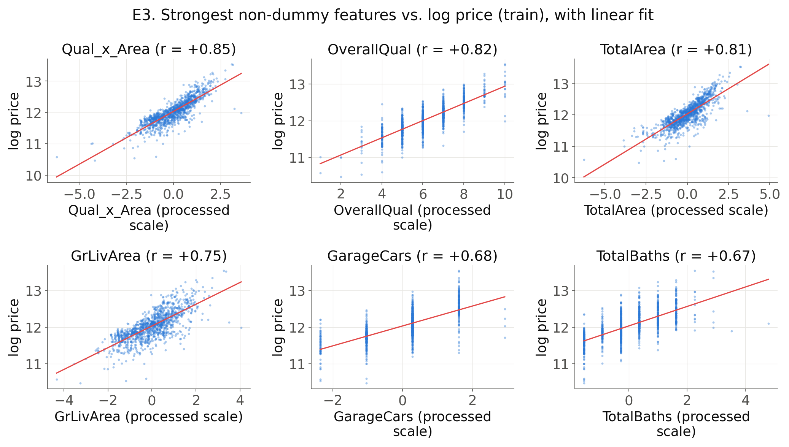
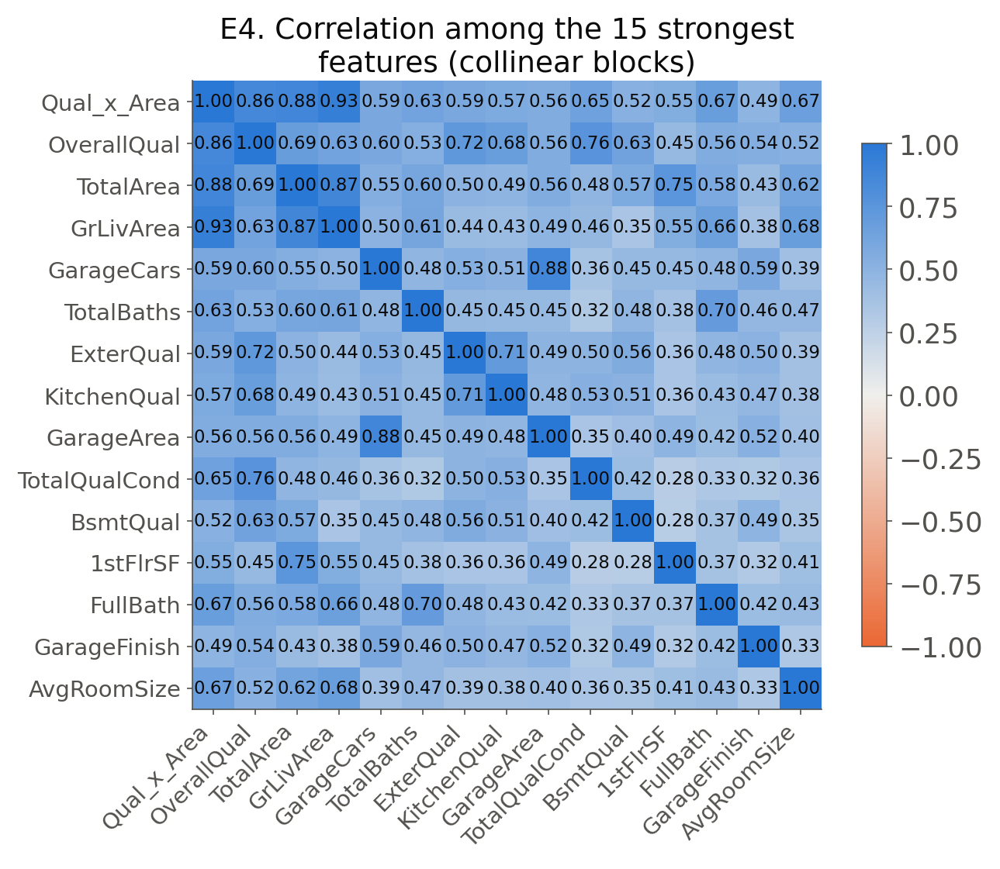
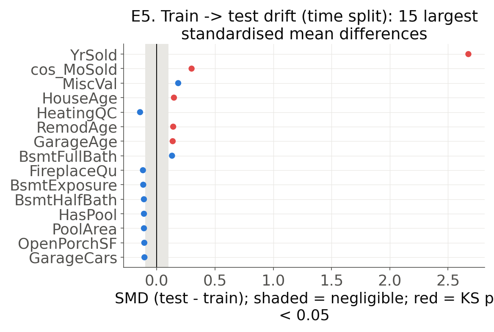
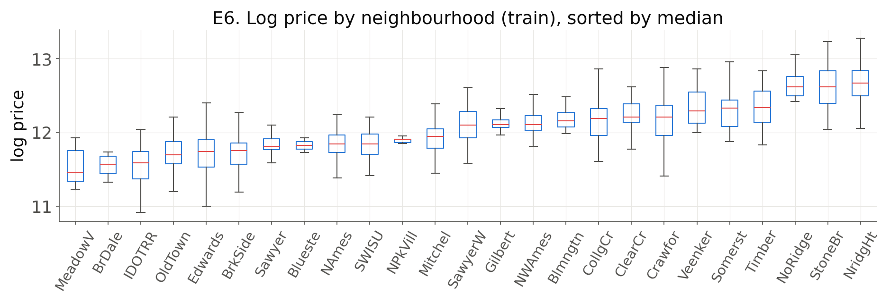

## 3. Pipeline and feature engineering (§5.1)

F15 shows each stage with its input and output. Every data-dependent step (log choice, |r| selection, scaling, outlier rule) is fitted on training rows only.

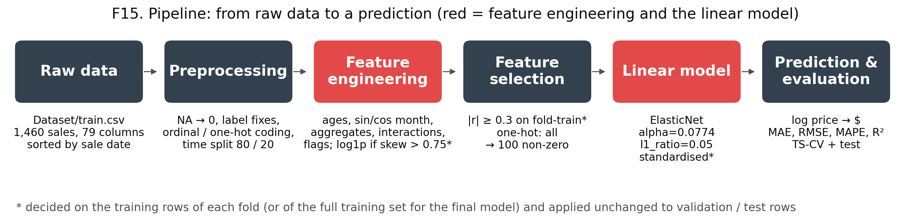

| Group | Features | Why it should help | Hypothesis |
|:---|:---|:---|:---|
| Transforms | log1p of skewed numerics (skew > 0.75, decided per fit); sin/cos of MoSold | makes area–price relations linear in logs; month becomes cyclic so Dec and Jan are neighbours | H1 |
| Interactions | Qual_x_Area, TotalQualCond | lets the quality effect grow with size (luxury premium); one combined condition score | H2, H5 |
| Aggregates | TotalArea, TotalBaths, TotalPorchArea | buyers value total usable space; one strong feature replaces several correlated parts | H1, H7 |
| Domain-derived | HouseAge, RemodAge, GarageAge; AvgRoomSize, LotUtilization | age at sale is what a buyer sees, not the calendar year; room size and lot use measure spaciousness | H1, H3 |
| Presence flags | HasBasement, HasFireplace, HasPool, HasGarage, IsRemod | capture the price step of having an amenity, separate from its size | H6 |

*Table 7: Engineered feature groups, the rationale for each and the hypothesis it addresses (§4).*

Whether these groups help as a whole is tested in the ablation (§7.2, Set B vs A).

## 4. Model choice and hyperparameter tuning (§5.2)

**Model.** Our features are strongly correlated (47 features have VIF ≥ 10, several effectively infinite because of exact identities such as HouseAge = YrSold − YearBuilt; E4, §8.1), and there are 290 candidate features for 1,168 training sales, most of them weak one-hot dummies (E2). We therefore use **ElasticNet** (Zou & Hastie 2005), which shrinks correlated coefficients together like Ridge and drops useless ones like Lasso. The choice is confirmed by CV: all penalised models beat plain OLS (CV RMSE 0.1519 vs. 0.1334; H7, S1), and ElasticNet is the best of the five.
Features are standardised inside each fold. We tune the |r| threshold, one-hot handling, outlier rule, α and l1_ratio by 5-fold TimeSeriesSplit on the **training period only**, minimising CV RMSE on log price. The selected values are threshold 0.3, one-hot = all, outliers kept, **α = 0.0774, l1_ratio = 0.05** (100 non-zero coefficients).

**Tuning curve.** T8 shows CV error along the α path at the selected setting. CV RMSE stays within one standard error of the optimum for α ≈ 0.00756–0.343, so the exact choice matters little there; larger α over-shrinks and the error rises (F4).

| α | CV MAE ($k) | CV RMSE |
|:---|---:|---:|
| 0.000673 | 20.1 | 0.1643 |
| 0.00206 | 19.4 | 0.1570 |
| 0.00628 | 18.2 | 0.1474 |
| 0.0192 | 17.0 | 0.1388 |
| 0.0586 | 16.3 | 0.1337 |
| **0.0774** | **16.3** | **0.1334** |
| 0.179 | 16.9 | 0.1372 |
| 0.546 | 19.8 | 0.1545 |
| 1.67 | 29.9 | 0.2153 |
| 5.09 | 53.5 | 0.3774 |
| 6.73 | 56.7 | 0.4011 |

*Table 8: Tuning curve of ElasticNet (l1_ratio = 0.05, threshold 0.3): time-series CV error along the α path. Bold = selected α.*

### 4.1 How the search ranges were decided

A fixed decade grid (1e-4 … 1e2) is a convention: the effect of a given α depends on the number of rows, the feature scales and how the library writes the loss. Ranges are therefore derived from the data.

- **Lasso / ElasticNet:** α_max = max |xⱼᵀy| / (n · l1_ratio) is the smallest α that zeroes every coefficient (0.337 for Lasso); the path runs down to 0.0001 · α_max (glmnet default for n > p).
- **Ridge:** never zeroes coefficients, so its range spans effective degrees of freedom df(α) = Σ dⱼ²/(dⱼ² + α) from about the rank (no shrinkage) to 1.
- **Edge rule:** a value chosen on the edge of its grid means the grid must be widened (done for l1_ratio and top-k).

| Setting | Values searched | Source |
|:---|:---|:---|
| Correlation threshold | 0, 0.1, 0.3, 0.5 | Cohen (1988) |
| One-hot dummies | none, filtered, all | — |
| Drop GrLivArea > 4000 (train folds) | False, True | De Cock (2011) |
| Lasso / ElasticNet α | 100 values, α_max → 0.0001·α_max (log) | Friedman et al. (2010) |
| ElasticNet l1_ratio | 0.01, 0.05, 0.1, 0.5, 0.7, 0.9, 0.95, 0.99 | Zou & Hastie (2005) |
| Ridge α | 30 values, df 1 → 0.95·rank (4.58 … 3.12e+05) | Hastie et al. (2009) §3.4.1 |
| Huber ε | 1.345, 2 | Huber (1981) |
| Huber α | 8 values from the ridge range | — |
| Grid spacing | logarithmic | Bergstra & Bengio (2012) |
| Cross-validation | TimeSeriesSplit, 5 folds | Bergmeir & Benítez (2012) |
| Top-k (ablation) | 5, 10, 15, 20, 30, 40, 60, 80, 120, 160, 200, 240, 260, 280 | — |
| Bootstrap resamples | B = 1000 | Efron & Tibshirani (1993) |

*Table 9: Tunable settings, the values searched and their sources.*

Search: 22 selection settings × 947 model hyperparameter values, each scored on 5 time-series folds.

| Model | Hyperparameters | r threshold | Dummies | Features | CV RMSE ± SD | CV MAE ($k) |
|:---|:---|---:|:---|---:|---:|---:|
| OLS | - | 0.3 | filtered | 54 | 0.1519 ± 0.0350 | 18.8 |
| Ridge | alpha=145 | 0.3 | all | 263 | 0.1354 ± 0.0283 | 16.3 |
| Lasso | alpha=0.00425 | 0.3 | all | 263 | 0.1345 ± 0.0306 | 16.4 |
| ElasticNet | alpha=0.0774, l1_ratio=0.05 | 0.3 | all | 263 | **0.1334 ± 0.0294** | **16.3** |
| Huber | epsilon=2.0, alpha=1.45e+03 | 0.3 | all | 263 | 0.1344 ± 0.0270 | 16.1 |

*Table S1: Best configuration per model family (time-series CV on the training set; lower is better).*

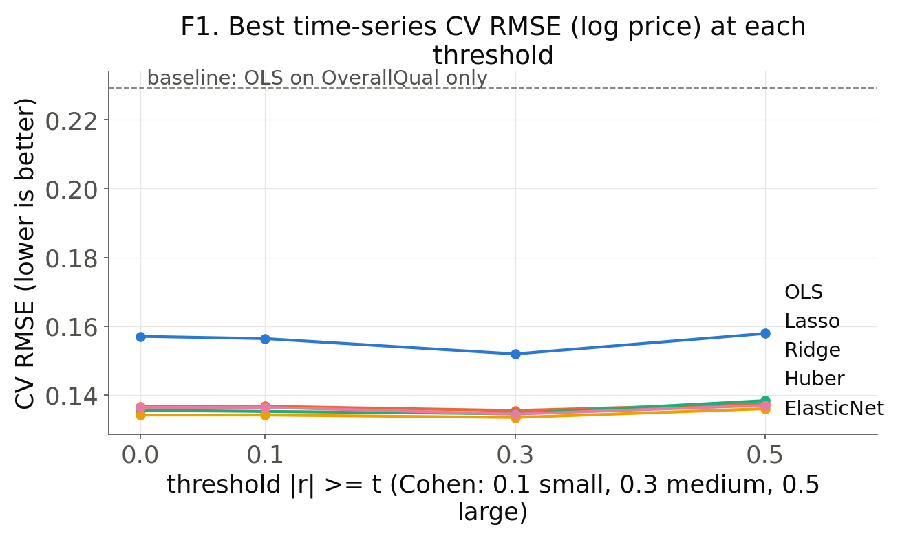
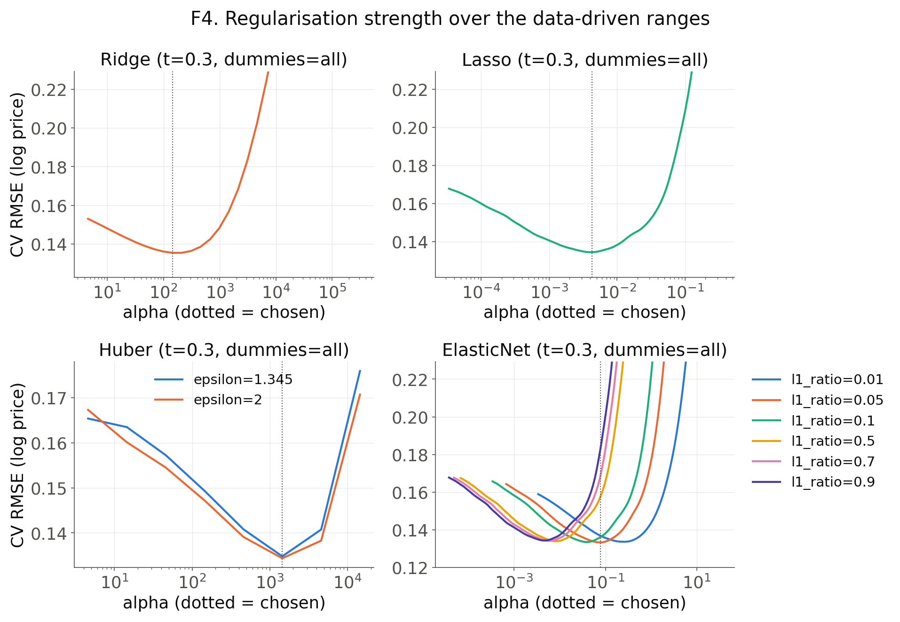
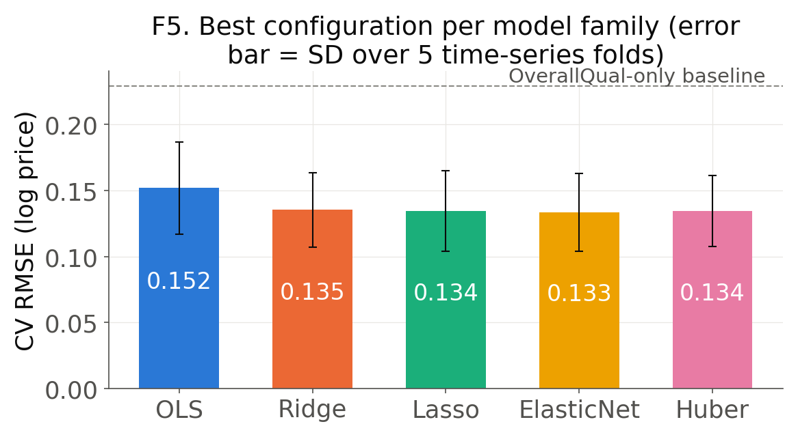

Top 10 configurations (all in `tuning_results.csv`):

| Rank | Model | Hyperparameters | r threshold | Dummies | Drop outliers | CV RMSE ± SD | CV MAE ($k) |
|:---|:---|:---|---:|:---|:---|---:|---:|
| 1 | ElasticNet | alpha=0.0774, l1_ratio=0.05 | 0.3 | all | no | **0.133370 ± 0.0294** | **16.3** |
| 2 | ElasticNet | alpha=0.0705, l1_ratio=0.05 | 0.3 | all | no | 0.133382 ± 0.0292 | 16.3 |
| 3 | ElasticNet | alpha=0.085, l1_ratio=0.05 | 0.3 | all | no | 0.133437 ± 0.0295 | 16.3 |
| 4 | ElasticNet | alpha=0.0643, l1_ratio=0.05 | 0.3 | all | no | 0.133487 ± 0.0291 | 16.3 |
| 5 | ElasticNet | alpha=0.0387, l1_ratio=0.1 | 0.3 | all | no | 0.133565 ± 0.0296 | 16.3 |
| 6 | ElasticNet | alpha=0.0932, l1_ratio=0.05 | 0.3 | all | no | 0.133597 ± 0.0295 | 16.4 |
| 7 | ElasticNet | alpha=0.0425, l1_ratio=0.1 | 0.3 | all | no | 0.133599 ± 0.0297 | 16.3 |
| 8 | ElasticNet | alpha=0.0353, l1_ratio=0.1 | 0.3 | all | no | 0.133610 ± 0.0295 | 16.3 |
| 9 | ElasticNet | alpha=0.0586, l1_ratio=0.05 | 0.3 | all | no | 0.133674 ± 0.0290 | 16.3 |
| 10 | ElasticNet | alpha=0.267, l1_ratio=0.01 | 0.3 | all | no | 0.133704 ± 0.0270 | 16.3 |

*Table 10: Top 10 of all tuned configurations, ranked by time-series CV RMSE.*

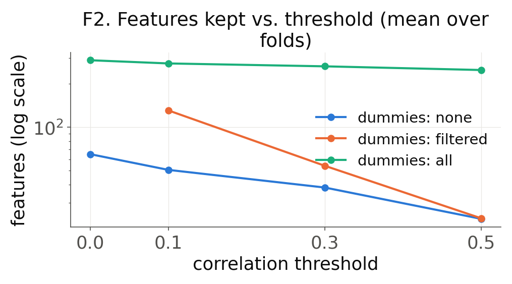
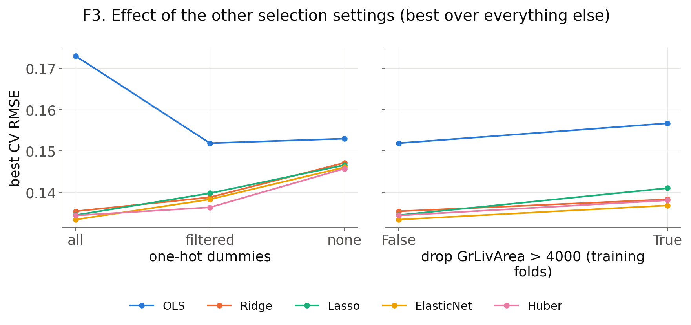

## 5. Metrics and baselines (§6)

**Metrics.** We report MAE in dollars as the primary metric, because a buyer, seller or lender loses money in proportion to the dollar error. We add RMSE on log price, the training objective, which penalises large relative misses, and three supporting metrics (T11).

**Decision threshold: MAE ≤ $16,500** (10% of the median training price, $165,000). Below this error an automated estimate is close enough to set a listing price or an offer without a manual appraisal. Above it, the estimate would change that decision. §7 compares every method against this threshold. The 10% band is our assumption about the user; adjust it if your problem statement defines a different user.

**Baselines** of increasing strength (T12) are scored with exactly the same protocol as our model: same time-series folds, then one fit on the full training set evaluated on the test set. They follow the team's `model/baseline2.py` (trivial / simple / strong tiers), plus a persistence baseline for the temporal setting.

| Metric | Unit | Emphasises | Caution | Why we use it |
|:---|:---|:---|:---|:---|
| MAE | $ | typical error size | weights all errors linearly | the user's cost: dollars a buyer or seller would misjudge; carries the decision threshold |
| RMSE | log price | large (relative) errors | sensitive to outliers | the training objective and Kaggle metric; ≈ relative error |
| MAPE | % | relative error | unstable when y ≈ 0 | comparable across cheap and expensive houses (prices are never near 0) |
| R² | none | variance explained | can be negative on test data | shows how much better than predicting the mean |
| Within ±10% | % of houses | share of usable estimates | ignores the size of misses | how often an estimate is close enough to act on |

*Table 11: Evaluation metrics and the reason for each.*

| Tier | Baseline | Inputs | Tuning |
|:---|:---|:---|:---|
| Trivial | Training mean | none | — |
| Trivial | Persistence (last 3 months) | median price of the last 3 months of the training part | — |
| Simple | Single-feature OLS (OverallQual) | OverallQual (strongest original feature, E2) | — |
| Simple | Single-feature OLS (log GrLivArea) | log living area (most intuitive size feature) | — |
| Strong | Gradient boosting (raw inputs) | all raw columns (one-hot coded) | best of 12 random-forest / gradient-boosting settings by the same CV (lr: 0.03, leaves: 8, l2: 0.0) |

*Table 12: Baselines of increasing strength.*

## 6. Main results (§7.1)

| Method | CV MAE ($k) | CV RMSE | Test MAE ($k) | Test RMSE | Test R² | Within ±10% (%) |
|:---|---:|---:|---:|---:|---:|---:|
| Training mean | 56.8 ± 3.3 | 0.4014 ± 0.0287 | 55.2 | 0.4092 | -0.010 | 18.5 |
| Persistence (last 3 months) | 57.3 ± 3.5 | 0.4083 ± 0.0288 | 54.8 | 0.4076 | -0.003 | 18.2 |
| Single-feature OLS (OverallQual) | 31.7 ± 2.5 | 0.2293 ± 0.0166 | 29.4 | 0.2371 | 0.661 | 38.4 |
| Single-feature OLS (log GrLivArea) | 37.6 ± 1.9 | 0.2682 ± 0.0132 | 41.0 | 0.3038 | 0.443 | 28.1 |
| Gradient boosting (raw inputs) | 19.3 ± 3.3 | 0.1526 ± 0.0253 | **14.9** | 0.1308 | 0.897 | **70.5** |
| Ours (ElasticNet + features) | **16.3 ± 2.8** | **0.1334 ± 0.0294** | 15.3 | **0.1229** | **0.909** | 68.8 |

*Table 13: Main results. CV: mean ± SD over 5 TimeSeriesSplit folds; test: chronological test set (292 sales). Bold = best in each column. Decision threshold: MAE ≤ $16.5k.*

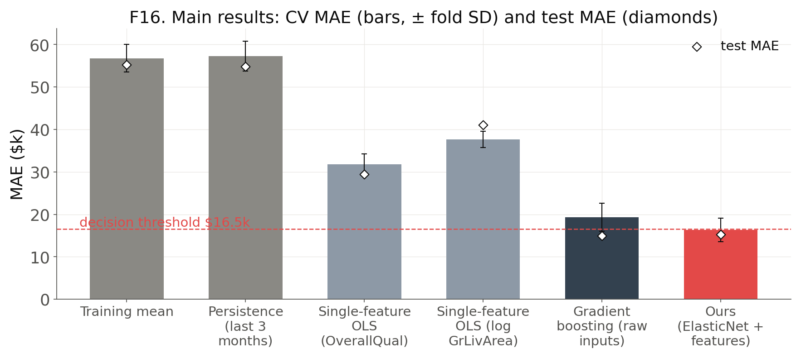

**Experimental results.**
- **Against the threshold:** on the test set Gradient boosting (raw inputs), Ours (ElasticNet + features) meet the $16.5k threshold. In CV, Ours (ElasticNet + features) does. The trivial and single-feature baselines miss it by a wide margin.
- **Against the strongest baseline (Gradient boosting (raw inputs)):** ours is better in CV by $2,981 MAE (corrected resampled t-test over folds, Nadeau & Bengio 2003: p = 0.058). On the test set our MAE is higher by $414 (paired bootstrap 95% CI of the gap [-1,840, +944] $, Wilcoxon p = 0.406). We therefore claim **performance on par with the strong baseline, not a win**.
- **Why the linear model keeps up with boosting:** per fold, the baseline − ours MAE gap is $5,484, $2,497, $2,183, $2,238, $2,500 for training sizes 198, 392, 586, 780, 974; with all 1,168 training sales the gap on the test set is -414 $. The linear model gets the shape of the relationships for free from the log transforms, ages and aggregates (§5.1), while the trees must learn every curve from the data, so the linear model's advantage is largest when training data are scarce and fades as data grow.
- Gap definitions: CV gap = baseline − ours (positive = ours better); test gap = baseline MAE − our MAE per house.

**Final model diagnostics** (T14, F7): typical error ≈ 12% of the price; mean residual -0.0077 (p = 0.287, no level shift between periods); Breusch-Pagan p = 0.003 (error variance grows with price, hence bootstrap intervals); Durbin-Watson 1.89 (no serial correlation).

| Metric | Value | 95% CI / test |
|:---|---:|:---|
| RMSE (log price) | 0.1229 | [0.1089, 0.1384] |
| MAE ($) | 15,309 | [13,529, 17,334] |
| Median absolute error ($) | 11,259 | — |
| MAPE (%) | 9.3 | — |
| R² (log price) | 0.909 | — |
| Mean residual (bias) | -0.0077 | t-test p = 0.287 |
| Breusch-Pagan | — | p = 0.003 |
| Durbin-Watson | 1.89 | — |

*Table 14: Final model (ElasticNet, 262 features, 100 non-zero) on the chronological test set; CIs from 1000 bootstrap resamples.*

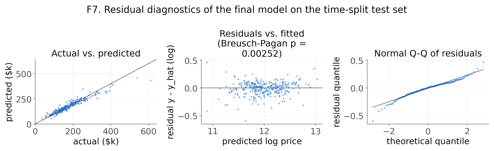

## 7. Feature ablation (§7.2)

Same model family (**ElasticNet**), chronological split, time-series folds, tuning procedure and outlier rule for every set; only the feature set changes.

| Set | Feature set | Features | CV MAE ($k) ± SD | Test MAE ($k) | Test RMSE |
|:---|:---|---:|---:|---:|---:|
| A | All original | 273 | 16.8 ± 3.1 | 15.4 | 0.1226 |
| B | All original + engineered | 290 | 16.4 ± 3.0 | 15.2 | 0.1219 |
| C | Top-k original | 260 | 16.8 ± 3.1 | 15.4 | 0.1226 |
| D | Top-k original + engineered | 280 | 16.4 ± 3.0 | **15.2** | **0.1219** |
| E | Greedy original | 91 | 21.7 ± 1.4 | 19.8 | 0.1574 |
| F | Greedy original + engineered | 96 | **16.2 ± 2.1** | 15.7 | 0.1261 |

*Table 15: Feature ablation. CV = time-series 5-fold on the training set (± fold SD); test = chronological test set. Bold = best.*

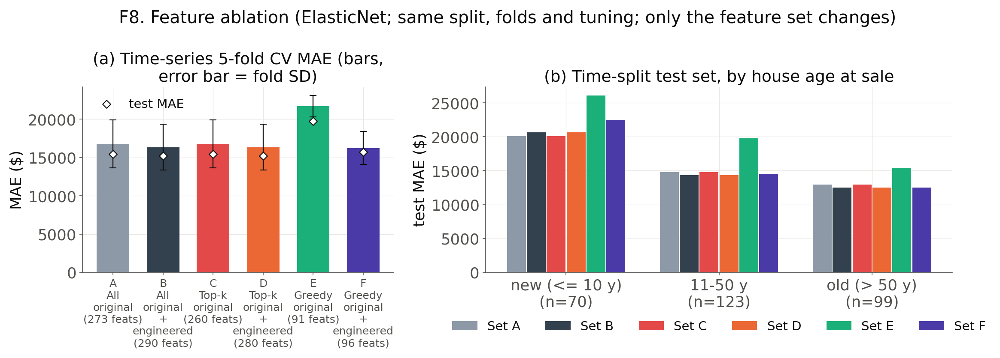

**Significance.** CV folds: corrected resampled t-test (Nadeau & Bengio 2003; variance × (1/k + n_val/n_train)). Test set: paired bootstrap of the mean absolute-error difference and the Wilcoxon signed-rank test (Wilcoxon 1945). All p-values are Holm-adjusted over the 15 pairs (Holm 1979). Δ = first set − second set, so positive = the second set is better.

| Comparison | Δ CV MAE ($k) | p (CV, t) | Δ test MAE ($k) [95% CI] | p (boot.) | p (Wilcoxon) |
|:---|---:|---:|---:|---:|---:|
| A vs B | +0.44 | 0.959 | +0.21 [-0.07, +0.48] | 1.000 | 1.000 |
| A vs C | +0.00 | 1.000 | +0.00 [+0.00, +0.00] | 0.280 | 0.127 |
| A vs D | +0.44 | 0.959 | +0.21 [-0.07, +0.48] | 1.000 | 1.000 |
| A vs E | -4.90 | 0.411 | -4.34 [-6.11, -2.57] | **<0.001** | **<0.001** |
| A vs F | +0.57 | 1.000 | -0.31 [-1.18, +0.61] | 1.000 | 1.000 |
| B vs C | -0.44 | 0.959 | -0.21 [-0.48, +0.07] | 1.000 | 1.000 |
| B vs D | -0.00 | 1.000 | +0.00 [-0.00, +0.00] | 1.000 | 1.000 |
| B vs E | -5.34 | 0.300 | -4.55 [-6.35, -2.72] | **<0.001** | **<0.001** |
| B vs F | +0.13 | 1.000 | -0.52 [-1.34, +0.34] | 1.000 | 1.000 |
| C vs D | +0.44 | 0.959 | +0.21 [-0.07, +0.48] | 1.000 | 1.000 |
| C vs E | -4.90 | 0.411 | -4.34 [-6.11, -2.57] | **<0.001** | **<0.001** |
| C vs F | +0.57 | 1.000 | -0.31 [-1.18, +0.61] | 1.000 | 1.000 |
| D vs E | -5.34 | 0.300 | -4.55 [-6.35, -2.72] | **<0.001** | **<0.001** |
| D vs F | +0.13 | 1.000 | -0.52 [-1.34, +0.34] | 1.000 | 1.000 |
| E vs F | +5.47 | 0.054 | +4.03 [+2.47, +5.75] | **<0.001** | **<0.001** |

*Table 16: Pairwise comparison of the feature sets (Holm-adjusted p; bold p < 0.05).*

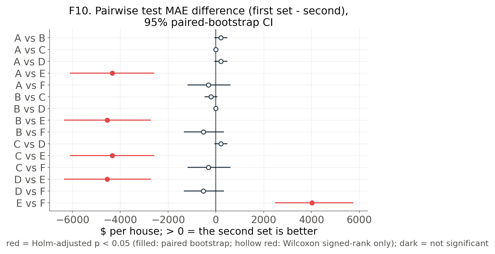

| Slice | n | A | B | C | D | E | F |
|:---|---:|---:|---:|---:|---:|---:|---:|
| Age: new (<= 10 y) | 70 | 20.1 | 20.6 | **20.1** | 20.6 | 26.0 | 22.5 |
| Age: 11-50 y | 123 | 14.8 | 14.3 | 14.8 | **14.3** | 19.7 | 14.5 |
| Age: old (> 50 y) | 99 | 12.9 | 12.5 | 12.9 | **12.5** | 15.4 | 12.5 |
| Size: small | 106 | 10.6 | 10.4 | 10.6 | 10.4 | 13.8 | **10.2** |
| Size: medium | 90 | 13.9 | 13.7 | 13.9 | **13.7** | 17.8 | 14.7 |
| Size: large | 96 | 22.2 | 21.9 | 22.2 | **21.9** | 28.2 | 22.8 |
| Sale: Normal | 251 | 13.9 | 13.6 | 13.9 | **13.6** | 18.4 | 13.9 |
| Sale: non-Normal | 41 | **25.1** | 25.2 | 25.1 | 25.2 | 28.2 | 26.8 |

*Table 17: Test MAE ($k) by slice of the test set (bold = best set in the row).*

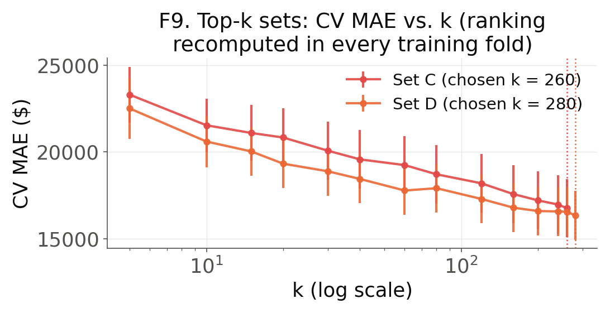

**Findings.**
- **Engineered features (B vs A, H6):** test MAE A − B = +206 $ [-67, +480], not significant after Holm.
- **Correlation ranking (C, D vs A, B):** the tuned k keeps essentially every feature, so C gives the same predictions as A, and D the same as B. Features a |r| filter would drop are already set to zero by ElasticNet.
- **Greedy original only (E):** worse than every other set (test MAE E − F = +4,026 $ [+2,473, +5,754], significant after Holm).
- **Greedy original + engineered (F) vs B:** test MAE B − F = -520 $ [-1,342, +345], not significant after Holm, with 96 instead of 290 features. Compare E and F on the test set only: their list was selected on the whole training set, so their CV scores are optimistic (Ambroise & McLachlan 2002).
### 7.1 Is the ablation design correct?

Yes: the six sets share the model family, split, folds, tuning procedure and outlier rule, and the top-k sets rank features inside each training fold. The one caveat is that the greedy sets (E, F) were selected on the whole training set, so their CV scores contain selection bias (Hastie et al. 2009 §7.10.2); their test scores are clean. The greedy p-values also come from an OLS fit with exact collinearity (e.g. HouseAge = YrSold − YearBuilt), which makes individual p-values unreliable.
## 8. Coefficients and statistical significance (§8.1)

- **Scale:** coefficients are standardised (β = change in log price per +1 SD of the feature).
- **Test:** nonparametric bootstrap (B = 1000; feature selection and fit repeated in every resample). Percentile 95% CI; two-sided p = 2·min(P*(β ≤ 0), P*(β ≥ 0)). *Sel. freq.* = share of resamples with a non-zero coefficient (Meinshausen & Bühlmann 2010).
- **VIF:** computed on a reference-coded design (one level per categorical dropped). `inf` = exact identity, e.g. HouseAge = YrSold − YearBuilt. Categoricals are judged as a group by GVIF^(1/(2df)) against √10 ≈ 3.16 (Fox & Monette 1992).
- **Practical significance:** effect on the median house ($165,000); below 1% of price counts as negligible (Wasserstein & Lazar 2016).

**Findings.** 35 of 262 features are significant (p < 0.05); 31 also change the median price by ≥ 1%, and 4 are significant but negligible (ExterQual, FireplaceQu, RemodAge, YearRemodAdd). There are **0 sign reversals** among 37 features with a prior hypothesis. 47 features have VIF ≥ 10: the area, quality and age blocks must be read as groups, not one coefficient at a time. Large but non-significant: RoofMatl_ClyTile (p = 0.70), rare categories with unstable estimates.

| Feature | Unit | β | 95% CI | p | Sel. freq. | VIF | Effect ($k) |
|:---|---:|---:|---:|---:|---:|---:|---:|
| TotalQualCond | +1 SD | +0.054 | [+0.043, +0.060] | <0.001 | 1.00 | 5.9 | +9.1 |
| TotalArea | +1 SD | +0.041 | [+0.026, +0.051] | <0.001 | 1.00 | **75.0** | +7.0 |
| LotArea | +1 SD | +0.034 | [+0.024, +0.042] | <0.001 | 1.00 | 5.3 | +5.6 |
| GrLivArea | +1 SD | +0.033 | [+0.026, +0.040] | <0.001 | 1.00 | **286.7** | +5.5 |
| TotalBaths | +1 SD | +0.026 | [+0.016, +0.035] | <0.001 | 1.00 | 5.6 | +4.4 |
| Qual_x_Area | +1 SD | +0.025 | [+0.019, +0.033] | <0.001 | 1.00 | **204.3** | +4.2 |
| GarageArea | +1 SD | +0.024 | [+0.012, +0.031] | <0.001 | 1.00 | 8.7 | +3.9 |
| 1stFlrSF | +1 SD | +0.023 | [+0.011, +0.033] | <0.001 | 1.00 | **19.8** | +3.8 |
| MSZoning_C | 0 -> 1 | -0.023 | [-0.039, -0.001] | 0.038 | 0.98 | 1.8 | -48.6 |
| OverallQual | +1 SD | +0.022 | [+0.012, +0.032] | <0.001 | 1.00 | **49.6** | +3.7 |
| TotRmsAbvGrd | +1 SD | +0.021 | [+0.012, +0.031] | <0.001 | 1.00 | **59.9** | +3.5 |
| Neighborhood_NridgHt | 0 -> 1 | +0.020 | [+0.011, +0.027] | <0.001 | 1.00 | 3.9 | +15.3 |

*Table 18: Significant and practically relevant coefficients of the final model (bootstrap 95% CI; effect on the median house for +1 SD or 0 → 1). Bold VIF ≥ 10.*

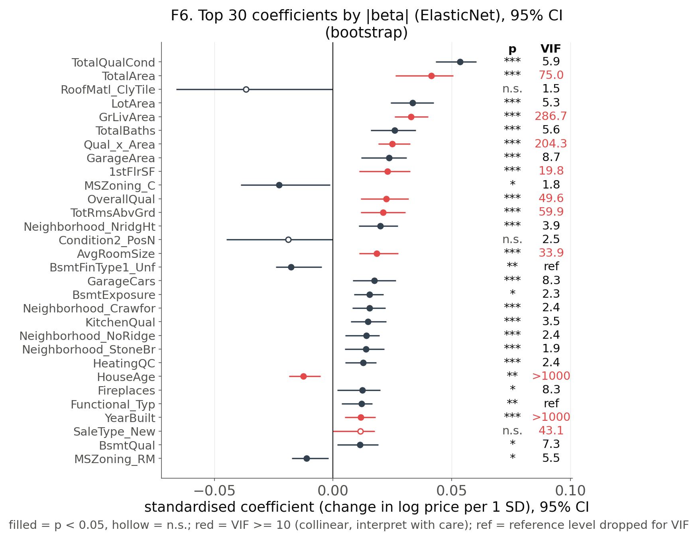

**Hypotheses revisited.** Each hypothesis from §4 (T6) against the evidence:

| Hypothesis | Evidence | Verdict |
|:---|:---|:---|
| H1 size | TotalArea: β = +0.041 [+0.026, +0.051], p < 0.001; GrLivArea: β = +0.033 [+0.026, +0.040], p < 0.001 | supported |
| H2 quality | OverallQual: β = +0.022 [+0.012, +0.032], p < 0.001; TotalQualCond: β = +0.054 [+0.043, +0.060], p < 0.001 | supported |
| H3 age | HouseAge: β = -0.012 [-0.019, -0.005], p = 0.002 (size and quality held fixed) | supported |
| H4 location | 4 neighbourhood dummies significant; zoning: MSZoning_C -29%, MSZoning_RM -3% | supported |
| H5 luxury premium | Qual_x_Area: β = +0.025 [+0.019, +0.033], p < 0.001 | supported |
| H6 engineered features | Set B vs A: test MAE +206 $ [-67, +480] (§7.2) | direction supported, not significant |
| H7 penalised > OLS | CV RMSE OLS 0.1519 vs. best penalised 0.1334 (S1) | supported |

*Table 19: The hypotheses of §4 revisited with the final model's coefficients and the ablation.*

| Categorical | df | GVIF^(1/(2df)) | Reference level |
|:---|---:|---:|:---|
| BldgType | 2 | **3.54** | BldgType_1Fam |
| HouseStyle | 7 | 3.09 | HouseStyle_1Story |
| MSSubClass | 13 | 2.52 | MSSubClass_20 |
| Exterior1st | 12 | 2.40 | Exterior1st_VinylSd |
| Exterior2nd | 14 | 2.17 | Exterior2nd_VinylSd |
| SaleCondition | 5 | 1.69 | SaleCondition_Normal |
| MSZoning | 4 | 1.69 | MSZoning_RL |
| CentralAir | 1 | 1.65 | CentralAir_Y |
| RoofStyle | 4 | 1.56 | RoofStyle_Gable |
| Foundation | 5 | 1.55 | Foundation_PConc |

*Table 20: Generalised VIF of categorical variables (values above 3.16 correspond to VIF > 10).*

Full coefficient table (262 features)

| feature | unit | beta | ci_lo | ci_hi | p | sel_freq | VIF | marginal_r | effect_usd | practical | hypothesis_check |
|---|---|---|---|---|---|---|---|---|---|---|---|
| TotalQualCond | +1 SD | 0.0535 | 0.0433 | 0.0604 | <0.001 | 1.0000 | 5.9305 | 0.6469 | 9,068 | yes | agrees |
| TotalArea | +1 SD | 0.0415 | 0.0264 | 0.0506 | <0.001 | 1.0000 | 75.0433 | 0.8060 | 6,990 | yes | agrees |
| RoofMatl_ClyTile | 0 -> 1 | -0.0367 | -0.0660 | 0.0000 | 0.698 | 0.6510 | 1.5212 | -0.0036 | -118,007 | yes | no prior hypothesis |
| LotArea | +1 SD | 0.0335 | 0.0244 | 0.0425 | <0.001 | 1.0000 | 5.3234 | 0.4053 | 5,623 | yes | agrees |
| GrLivArea | +1 SD | 0.0329 | 0.0260 | 0.0400 | <0.001 | 1.0000 | 286.7157 | 0.7456 | 5,526 | yes | agrees |
| TotalBaths | +1 SD | 0.0261 | 0.0159 | 0.0349 | <0.001 | 1.0000 | 5.6299 | 0.6679 | 4,356 | yes | agrees |
| Qual_x_Area | +1 SD | 0.0249 | 0.0191 | 0.0326 | <0.001 | 1.0000 | 204.2530 | 0.8481 | 4,166 | yes | agrees |
| GarageArea | +1 SD | 0.0236 | 0.0118 | 0.0310 | <0.001 | 1.0000 | 8.7116 | 0.6514 | 3,936 | yes | agrees |
| 1stFlrSF | +1 SD | 0.0230 | 0.0109 | 0.0325 | <0.001 | 1.0000 | 19.8273 | 0.6040 | 3,833 | yes | agrees |
| MSZoning_C | 0 -> 1 | -0.0228 | -0.0388 | -0.0013 | 0.038 | 0.9810 | 1.8166 | -0.1452 | -48,598 | yes | no prior hypothesis |
| OverallQual | +1 SD | 0.0224 | 0.0117 | 0.0318 | <0.001 | 1.0000 | 49.6159 | 0.8178 | 3,733 | yes | agrees |
| TotRmsAbvGrd | +1 SD | 0.0210 | 0.0118 | 0.0305 | <0.001 | 1.0000 | 59.9209 | 0.5576 | 3,506 | yes | agrees |
| Neighborhood_NridgHt | 0 -> 1 | 0.0199 | 0.0108 | 0.0273 | <0.001 | 1.0000 | 3.8737 | 0.3620 | 15,298 | yes | no prior hypothesis |
| Condition2_PosN | 0 -> 1 | -0.0189 | -0.0449 | 0.0000 | 0.684 | 0.6580 | 2.4501 | 0.0482 | -60,527 | yes | no prior hypothesis |
| AvgRoomSize | +1 SD | 0.0185 | 0.0110 | 0.0274 | <0.001 | 1.0000 | 33.9140 | 0.5830 | 3,076 | yes | agrees |
| BsmtFinType1_Unf | 0 -> 1 | -0.0177 | -0.0240 | -0.0047 | 0.006 | 0.9970 |  | -0.0829 | -6,236 | yes | no prior hypothesis |
| GarageCars | +1 SD | 0.0175 | 0.0084 | 0.0264 | <0.001 | 1.0000 | 8.3470 | 0.6824 | 2,908 | yes | agrees |
| BsmtExposure | +1 SD | 0.0155 | 0.0088 | 0.0212 | 0.010 | 0.9950 | 2.3359 | 0.3709 | 2,570 | yes | agrees |
| Neighborhood_Crawfor | 0 -> 1 | 0.0154 | 0.0081 | 0.0221 | <0.001 | 1.0000 | 2.4261 | 0.0788 | 13,928 | yes | no prior hypothesis |
| KitchenQual | +1 SD | 0.0147 | 0.0074 | 0.0225 | <0.001 | 1.0000 | 3.4883 | 0.6589 | 2,438 | yes | agrees |
| Neighborhood_NoRidge | 0 -> 1 | 0.0140 | 0.0052 | 0.0196 | <0.001 | 1.0000 | 2.4495 | 0.2875 | 14,536 | yes | no prior hypothesis |
| Neighborhood_StoneBr | 0 -> 1 | 0.0139 | 0.0050 | 0.0216 | <0.001 | 1.0000 | 1.9143 | 0.1819 | 19,696 | yes | no prior hypothesis |
| HeatingQC | +1 SD | 0.0127 | 0.0051 | 0.0183 | <0.001 | 1.0000 | 2.4305 | 0.4661 | 2,105 | yes | agrees |
| HouseAge | +1 SD | -0.0124 | -0.0186 | -0.0053 | 0.002 | 0.9990 | 2437152.1307 | -0.5711 | -2,041 | yes | agrees |
| Fireplaces | +1 SD | 0.0124 | 0.0017 | 0.0199 | 0.018 | 0.9910 | 8.2959 | 0.5059 | 2,066 | yes | agrees |
| Functional_Typ | 0 -> 1 | 0.0120 | 0.0037 | 0.0165 | 0.006 | 0.9970 |  | 0.1451 | 8,207 | yes | no prior hypothesis |
| YearBuilt | +1 SD | 0.0117 | 0.0050 | 0.0179 | <0.001 | 1.0000 | 2434966.1614 | 0.5707 | 1,938 | yes | agrees |
| SaleType_New | 0 -> 1 | 0.0115 | 0.0000 | 0.0176 | 0.068 | 0.9660 | 43.0926 | 0.3294 | 6,734 | yes | no prior hypothesis |
| BsmtQual | +1 SD | 0.0113 | 0.0017 | 0.0192 | 0.020 | 0.9900 | 7.2602 | 0.6165 | 1,882 | yes | agrees |
| MSZoning_RM | 0 -> 1 | -0.0111 | -0.0174 | -0.0019 | 0.014 | 0.9930 | 5.5187 | -0.3444 | -4,975 | yes | no prior hypothesis |
| Functional_Maj2 | 0 -> 1 | -0.0103 | -0.0178 | -0.0020 | 0.016 | 0.9920 | 1.5338 | -0.1182 | -23,992 | yes | no prior hypothesis |
| ExterQual | +1 SD | 0.0092 | 0.0017 | 0.0165 | 0.032 | 0.9840 | 4.0958 | 0.6636 | 1,533 | negligible | agrees |
| Exterior1st_BrkFace | 0 -> 1 | 0.0090 | 0.0016 | 0.0155 | 0.022 | 0.9890 | 7.7562 | 0.0139 | 8,511 | yes | no prior hypothesis |
| FireplaceQu | +1 SD | 0.0089 | 0.0005 | 0.0167 | 0.038 | 0.9810 | 18.2069 | 0.5554 | 1,480 | negligible | agrees |
| RemodAge | +1 SD | -0.0080 | -0.0122 | -0.0029 | <0.001 | 1.0000 | 1120763.8884 | -0.5609 | -1,311 | negligible | agrees |
| Condition1_Norm | 0 -> 1 | 0.0079 | 0.0009 | 0.0135 | 0.022 | 0.9890 |  | 0.1092 | 3,894 | yes | no prior hypothesis |
| RoofMatl_WdShngl | 0 -> 1 | 0.0079 | 0.0000 | 0.0159 | 0.110 | 0.9450 | 1.3305 | 0.1323 | 19,270 | yes | no prior hypothesis |
| SaleCondition_Abnorml | 0 -> 1 | -0.0078 | -0.0151 | 0.0000 | 0.066 | 0.9670 | 1.5373 | -0.1375 | -5,043 | yes | no prior hypothesis |
| HalfBath | +1 SD | 0.0076 | 0.0000 | 0.0146 | 0.460 | 0.7700 | 4.1801 | 0.3186 | 1,267 | negligible | CI includes 0: sign not established |
| LotConfig_CulDSac | 0 -> 1 | 0.0074 | 0.0016 | 0.0118 | 0.008 | 0.9960 | 1.4352 | 0.1444 | 5,147 | yes | no prior hypothesis |
| Neighborhood_Somerst | 0 -> 1 | 0.0073 | 0.0000 | 0.0131 | 0.352 | 0.8240 | 6.5324 | 0.1661 | 5,216 | yes | no prior hypothesis |
| Neighborhood_BrkSide | 0 -> 1 | 0.0070 | 0.0000 | 0.0118 | 0.114 | 0.9430 | 3.4123 | -0.1877 | 5,717 | yes | no prior hypothesis |
| YearRemodAdd | +1 SD | 0.0065 | 0.0020 | 0.0108 | 0.008 | 0.9960 | 1125366.0144 | 0.5588 | 1,070 | negligible | agrees |
| Functional_Sev | 0 -> 1 | -0.0064 | -0.0134 | 0.0000 | 0.744 | 0.6280 | 1.6213 | -0.0195 | -32,317 | yes | no prior hypothesis |
| Condition1_Artery | 0 -> 1 | -0.0061 | -0.0124 | 0.0000 | 0.052 | 0.9740 | 1.4612 | -0.1120 | -5,926 | yes | no prior hypothesis |
| Exterior1st_BrkComm | 0 -> 1 | -0.0060 | -0.0218 | 0.0000 | 0.740 | 0.6370 | 3.6299 | -0.0912 | -22,373 | yes | no prior hypothesis |
| GarageFinish | +1 SD | 0.0059 | 0.0000 | 0.0119 | 0.148 | 0.9260 | 3.3874 | 0.5936 | 977 | negligible | CI includes 0: sign not established |
| MSSubClass_30 | 0 -> 1 | -0.0058 | -0.0152 | 0.0000 | 0.176 | 0.9120 | 3.0820 | -0.3310 | -4,443 | yes | no prior hypothesis |
| PavedDrive_Y | 0 -> 1 | 0.0055 | 0.0000 | 0.0123 | 0.304 | 0.8480 |  | 0.3001 | 3,355 | yes | no prior hypothesis |
| BldgType_1Fam | 0 -> 1 | 0.0055 | 0.0000 | 0.0133 | 0.172 | 0.9140 |  | 0.1254 | 2,454 | yes | no prior hypothesis |
| Neighborhood_Edwards | 0 -> 1 | -0.0050 | -0.0131 | 0.0000 | 0.292 | 0.8540 | 2.3938 | -0.2053 | -3,243 | yes | no prior hypothesis |
| Neighborhood_OldTown | 0 -> 1 | -0.0047 | -0.0136 | 0.0000 | 0.208 | 0.8960 | 5.2758 | -0.2242 | -2,936 | yes | no prior hypothesis |
| BsmtFinType1_GLQ | 0 -> 1 | 0.0046 | 0.0000 | 0.0113 | 0.148 | 0.9260 | 3.1139 | 0.4204 | 1,716 | yes | no prior hypothesis |
| GarageType_2Types | 0 -> 1 | -0.0045 | -0.0088 | 0.0000 | 0.206 | 0.8970 | 1.5007 | -0.0241 | -10,018 | yes | no prior hypothesis |
| Foundation_PConc | 0 -> 1 | 0.0045 | 0.0000 | 0.0113 | 0.246 | 0.8770 |  | 0.5142 | 1,482 | negligible | no prior hypothesis |
| WoodDeckSF | +1 SD | 0.0043 | 0.0000 | 0.0095 | 0.284 | 0.8580 | 2.5637 | 0.3674 | 710 | negligible | CI includes 0: sign not established |
| Foundation_BrkTil | 0 -> 1 | -0.0041 | -0.0112 | 0.0000 | 0.500 | 0.7500 | 3.1740 | -0.2623 | -2,195 | yes | no prior hypothesis |
| Heating_Grav | 0 -> 1 | -0.0039 | -0.0179 | 0.0000 | 0.672 | 0.6830 | 1.6572 | -0.1606 | -8,712 | yes | no prior hypothesis |
| CentralAir_N | 0 -> 1 | -0.0037 | -0.0080 | 0.0000 | 0.082 | 0.9590 | 2.7371 | -0.3496 | -2,424 | yes | no prior hypothesis |
| CentralAir_Y | 0 -> 1 | 0.0037 | 0.0000 | 0.0080 | 0.082 | 0.9590 |  | 0.3496 | 2,460 | yes | no prior hypothesis |
| Condition1_Feedr | 0 -> 1 | -0.0034 | -0.0095 | 0.0000 | 0.428 | 0.7860 | 1.5216 | -0.1299 | -2,380 | yes | no prior hypothesis |
| OpenPorchSF | +1 SD | 0.0033 | 0.0000 | 0.0091 | 0.388 | 0.8060 | 2.5323 | 0.4684 | 539 | negligible | CI includes 0: sign not established |
| MSSubClass_90 | 0 -> 1 | -0.0032 | -0.0071 | 0.0000 | 0.144 | 0.9280 | inf | -0.1246 | -2,781 | yes | no prior hypothesis |
| BldgType_Duplx | 0 -> 1 | -0.0032 | -0.0071 | 0.0000 | 0.144 | 0.9280 | inf | -0.1246 | -2,781 | yes | no prior hypothesis |
| Exterior2nd_HdBoard | 0 -> 1 | -0.0032 | -0.0074 | 0.0000 | 0.216 | 0.8920 | 26.8306 | -0.0521 | -1,513 | negligible | no prior hypothesis |
| Heating_GasW | 0 -> 1 | 0.0031 | 0.0000 | 0.0082 | 0.826 | 0.5870 | 1.7215 | -0.0365 | 4,318 | yes | no prior hypothesis |
| GarageQual | +1 SD | 0.0030 | 0.0000 | 0.0108 | 0.454 | 0.7730 | 21.2447 | 0.3665 | 491 | negligible | CI includes 0: sign not established |
| MasVnrType_BrkCmn | 0 -> 1 | -0.0028 | -0.0082 | 0.0000 | 0.538 | 0.7320 | 1.3599 | -0.0521 | -4,164 | yes | no prior hypothesis |
| RoofStyle_Hip | 0 -> 1 | 0.0026 | 0.0000 | 0.0078 | 0.720 | 0.6400 | 1.5703 | 0.2182 | 1,082 | negligible | no prior hypothesis |
| SaleCondition_Partial | 0 -> 1 | 0.0026 | 0.0000 | 0.0145 | 0.688 | 0.6560 | 42.7837 | 0.3238 | 1,450 | negligible | no prior hypothesis |
| SaleCondition_Family | 0 -> 1 | -0.0024 | -0.0149 | 0.0000 | 0.764 | 0.6410 | 1.1822 | -0.0461 | -3,337 | yes | no prior hypothesis |
| Neighborhood_NWAmes | 0 -> 1 | -0.0023 | -0.0086 | 0.0000 | 0.496 | 0.7520 | 2.0966 | 0.0546 | -1,778 | yes | no prior hypothesis |
| Neighborhood_MeadowV | 0 -> 1 | -0.0021 | -0.0075 | 0.0000 | 0.224 | 0.8880 | 2.8698 | -0.1292 | -3,407 | yes | no prior hypothesis |
| Condition2_Feedr | 0 -> 1 | -0.0020 | -0.0053 | 0.0000 | 1.000 | 0.4880 | 2.0744 | -0.0555 | -6,455 | yes | no prior hypothesis |
| LandSlope_Mod | 0 -> 1 | 0.0020 | 0.0000 | 0.0074 | 0.844 | 0.5780 | 1.9954 | 0.0342 | 1,587 | negligible | no prior hypothesis |
| MSSubClass_160 | 0 -> 1 | -0.0019 | -0.0086 | 0.0000 | 0.480 | 0.7600 | 13.9773 | -0.1171 | -1,519 | negligible | no prior hypothesis |
| MSSubClass_20 | 0 -> 1 | 0.0019 | 0.0000 | 0.0078 | 0.968 | 0.5160 |  | 0.0353 | 658 | negligible | no prior hypothesis |
| RoofStyle_Gable | 0 -> 1 | -0.0017 | -0.0079 | 0.0000 | 0.692 | 0.6540 |  | -0.2045 | -680 | negligible | no prior hypothesis |
| Condition1_RRAe | 0 -> 1 | -0.0013 | -0.0051 | 0.0000 | 0.546 | 0.7270 | 1.4023 | -0.0381 | -2,579 | yes | no prior hypothesis |
| Exterior1st_Wd Sdng | 0 -> 1 | -0.0012 | -0.0080 | 0.0000 | 0.710 | 0.6450 | 21.6255 | -0.1867 | -573 | negligible | no prior hypothesis |
| Heating_OthW | 0 -> 1 | -0.0010 | -0.0049 | 0.0000 | 0.904 | 0.5480 | 1.3892 | -0.0303 | -4,081 | yes | no prior hypothesis |
| Alley_Grvl | 0 -> 1 | -0.0010 | -0.0090 | 0.0000 | 0.966 | 0.5170 |  | -0.1727 | -906 | negligible | no prior hypothesis |
| Exterior2nd_ImStucc | 0 -> 1 | 0.0010 | 0.0000 | 0.0089 | 0.936 | 0.5330 | 2.4662 | 0.0672 | 1,906 | yes | no prior hypothesis |
| Exterior1st_MetalSd | 0 -> 1 | 0.0010 | 0.0000 | 0.0046 | 1.000 | 0.4170 | 54.0786 | -0.1775 | 457 | negligible | no prior hypothesis |
| Condition2_Norm | 0 -> 1 | 0.0009 | 0.0000 | 0.0073 | 0.858 | 0.5720 |  | 0.0301 | 1,534 | negligible | no prior hypothesis |
| Utilities_NoSeWa | 0 -> 1 | -0.0008 | -0.0030 | 0.0000 | 0.764 | 0.6180 | 1.6563 | -0.0148 | -4,291 | yes | no prior hypothesis |
| Utilities_AllPub | 0 -> 1 | 0.0008 | 0.0000 | 0.0030 | 0.764 | 0.6180 |  | 0.0148 | 4,403 | yes | no prior hypothesis |
| Alley_Pave | 0 -> 1 | 0.0007 | 0.0000 | 0.0081 | 0.914 | 0.5430 | 2.0499 | -0.0087 | 681 | negligible | no prior hypothesis |
| MSZoning_FV | 0 -> 1 | 0.0007 | 0.0000 | 0.0094 | 0.906 | 0.5470 | 5.0613 | 0.1047 | 558 | negligible | no prior hypothesis |
| LandContour_Bnk | 0 -> 1 | -0.0007 | -0.0069 | 0.0000 | 1.000 | 0.4240 | 1.7138 | -0.1135 | -529 | negligible | no prior hypothesis |
| BsmtFinType1_LwQ | 0 -> 1 | -0.0005 | -0.0057 | 0.0000 | 0.848 | 0.5760 | 1.7248 | -0.0641 | -366 | negligible | no prior hypothesis |
| LotConfig_FR2 | 0 -> 1 | -0.0005 | -0.0047 | 0.0000 | 0.916 | 0.5420 | 1.2933 | 0.0134 | -432 | negligible | no prior hypothesis |
| TotalPorchArea | +1 SD | 0.0004 | 0.0000 | 0.0073 | 0.984 | 0.5080 | 3.2019 | 0.4003 | 65 | negligible | CI includes 0: sign not established |
| SaleType_COD | 0 -> 1 | -0.0004 | -0.0069 | 0.0000 | 1.000 | 0.4990 | 1.4492 | -0.0960 | -393 | negligible | no prior hypothesis |
| Functional_Maj1 | 0 -> 1 | -0.0003 | -0.0074 | 0.0000 | 0.860 | 0.5710 | 1.5457 | -0.0479 | -441 | negligible | no prior hypothesis |
| SaleType_Con | 0 -> 1 | 0.0002 | 0.0000 | 0.0030 | 1.000 | 0.4460 | 1.2271 | 0.0484 | 1,385 | negligible | no prior hypothesis |
| BsmtFinType2_ALQ | 0 -> 1 | 0.0002 | 0.0000 | 0.0063 | 0.986 | 0.5070 | 1.3717 | 0.0590 | 274 | negligible | no prior hypothesis |
| GarageType_CarPort | 0 -> 1 | -0.0001 | -0.0087 | 0.0000 | 1.000 | 0.5210 | 1.6365 | -0.0690 | -288 | negligible | no prior hypothesis |
| Condition2_PosA | 0 -> 1 | 0.0001 | 0.0000 | 0.0033 | 1.000 | 0.3640 | 1.4267 | 0.0486 | 616 | negligible | no prior hypothesis |
| Neighborhood_IDOTRR | 0 -> 1 | -0.0000 | -0.0068 | 0.0000 | 1.000 | 0.4940 | 3.2280 | -0.2091 | -13 | negligible | no prior hypothesis |
| Exterior2nd_Stucco | 0 -> 1 | 0.0000 | -0.0018 | 0.0034 | 1.000 | 0.1990 | 6.2550 | -0.0520 | 0 | negligible | no prior hypothesis |
| Exterior2nd_Wd Sdng | 0 -> 1 | -0.0000 | 0.0000 | 0.0000 | 1.000 | 0.0200 | 21.1520 | -0.1887 | -0 | negligible | no prior hypothesis |
| Exterior2nd_VinylSd | 0 -> 1 | 0.0000 | 0.0000 | 0.0006 | 1.000 | 0.0380 |  | 0.3296 | 0 | negligible | no prior hypothesis |
| BsmtFinType2_LwQ | 0 -> 1 | 0.0000 | 0.0000 | 0.0011 | 1.000 | 0.0910 | 1.3327 | -0.0102 | 0 | negligible | no prior hypothesis |
| MasVnrType_Stone | 0 -> 1 | 0.0000 | 0.0000 | 0.0074 | 0.996 | 0.5030 | 1.9052 | 0.3065 | 0 | negligible | no prior hypothesis |
| BsmtFinType2_Rec | 0 -> 1 | -0.0000 | -0.0023 | 0.0000 | 1.000 | 0.1850 | 1.4487 | -0.0271 | -0 | negligible | no prior hypothesis |
| Exterior2nd_Stone | 0 -> 1 | -0.0000 | -0.0031 | 0.0000 | 1.000 | 0.1980 | 2.2745 | -0.0221 | -0 | negligible | no prior hypothesis |
| Heating_Floor | 0 -> 1 | -0.0000 | -0.0000 | 0.0000 | 1.000 | 0.0070 | 1.3058 | -0.0620 | -0 | negligible | no prior hypothesis |
| Heating_GasA | 0 -> 1 | -0.0000 | -0.0001 | 0.0000 | 1.000 | 0.0430 |  | 0.1525 | -0 | negligible | no prior hypothesis |
| Exterior2nd_PreCast | 0 -> 1 | 0.0000 | 0.0000 | 0.0000 | 1.000 | 0.0000 |  | 0.0000 | 0 | negligible | no prior hypothesis |
| MSSubClass_40 | 0 -> 1 | -0.0000 | -0.0057 | 0.0000 | 1.000 | 0.4870 | 1.5966 | -0.0443 | -0 | negligible | no prior hypothesis |
| Exterior2nd_Plywood | 0 -> 1 | -0.0000 | -0.0004 | 0.0000 | 1.000 | 0.0460 | 15.8919 | -0.0124 | -0 | negligible | no prior hypothesis |
| Exterior2nd_Other | 0 -> 1 | -0.0000 | 0.0000 | 0.0000 | 1.000 | 0.0020 | 1.1101 | 0.0473 | -0 | negligible | no prior hypothesis |
| Heating_Wall | 0 -> 1 | 0.0000 | 0.0000 | 0.0005 | 1.000 | 0.0480 | 1.7596 | -0.0890 | 0 | negligible | no prior hypothesis |
| BsmtFinType2_Unf | 0 -> 1 | -0.0000 | -0.0019 | 0.0000 | 1.000 | 0.0830 |  | 0.1002 | -0 | negligible | no prior hypothesis |
| BsmtFinType2_BLQ | 0 -> 1 | -0.0000 | -0.0032 | 0.0000 | 1.000 | 0.3260 | 1.2897 | -0.0338 | -0 | negligible | no prior hypothesis |
| MSSubClass_70 | 0 -> 1 | 0.0000 | -0.0000 | 0.0034 | 1.000 | 0.1550 | 8.4964 | -0.0356 | 0 | negligible | no prior hypothesis |
| Foundation_Stone | 0 -> 1 | 0.0000 | 0.0000 | 0.0035 | 1.000 | 0.2220 | 1.5786 | -0.0050 | 0 | negligible | no prior hypothesis |
| MasVnrType_CBlock | 0 -> 1 | 0.0000 | 0.0000 | 0.0000 | 1.000 | 0.0000 |  | 0.0000 | 0 | negligible | no prior hypothesis |
| MasVnrType_BrkFace | 0 -> 1 | 0.0000 | 0.0000 | 0.0008 | 1.000 | 0.0500 |  | 0.2222 | 0 | negligible | no prior hypothesis |
| MSSubClass_75 | 0 -> 1 | 0.0000 | 0.0000 | 0.0021 | 1.000 | 0.1280 | 6.5281 | 0.0163 | 0 | negligible | no prior hypothesis |
| Foundation_CBlock | 0 -> 1 | -0.0000 | -0.0025 | 0.0000 | 1.000 | 0.0910 | 4.3407 | -0.3163 | -0 | negligible | no prior hypothesis |
| MSSubClass_60 | 0 -> 1 | 0.0000 | 0.0000 | 0.0035 | 1.000 | 0.1270 | 33.8601 | 0.4175 | 0 | negligible | no prior hypothesis |
| HasFireplace | 0 -> 1 | 0.0000 | 0.0000 | 0.0075 | 0.892 | 0.5540 | 23.7239 | 0.5244 | 0 | negligible | CI includes 0: sign not established |
| Foundation_Wood | 0 -> 1 | 0.0000 | 0.0000 | 0.0018 | 1.000 | 0.2240 | 1.1786 | 0.0293 | 0 | negligible | no prior hypothesis |
| BsmtFinType2_GLQ | 0 -> 1 | 0.0000 | 0.0000 | 0.0012 | 1.000 | 0.0790 | 1.5664 | 0.0206 | 0 | negligible | no prior hypothesis |
| MSSubClass_50 | 0 -> 1 | -0.0000 | -0.0016 | 0.0000 | 1.000 | 0.0860 | 21.3067 | -0.1732 | -0 | negligible | no prior hypothesis |
| BsmtFinType1_ALQ | 0 -> 1 | 0.0000 | 0.0000 | 0.0038 | 1.000 | 0.2790 | 2.4859 | -0.0874 | 0 | negligible | no prior hypothesis |
| BsmtFinType1_BLQ | 0 -> 1 | 0.0000 | 0.0000 | 0.0005 | 1.000 | 0.0490 | 2.1522 | -0.1306 | 0 | negligible | no prior hypothesis |
| BsmtFinType1_Rec | 0 -> 1 | -0.0000 | -0.0012 | 0.0000 | 1.000 | 0.0800 | 2.0104 | -0.1186 | -0 | negligible | no prior hypothesis |
| Exterior2nd_WdShing | 0 -> 1 | -0.0000 | -0.0058 | 0.0000 | 1.000 | 0.4680 | 4.8876 | -0.0569 | -0 | negligible | no prior hypothesis |
| MSSubClass_45 | 0 -> 1 | 0.0000 | 0.0000 | 0.0003 | 1.000 | 0.0380 | 17.3476 | -0.1037 | 0 | negligible | no prior hypothesis |
| Foundation_Slab | 0 -> 1 | 0.0000 | 0.0000 | 0.0036 | 1.000 | 0.1970 | 4.9009 | -0.1602 | 0 | negligible | no prior hypothesis |
| Functional_Mod | 0 -> 1 | -0.0000 | -0.0067 | 0.0004 | 1.000 | 0.3190 | 1.5628 | -0.0299 | -0 | negligible | no prior hypothesis |
| Electrical_SBrkr | 0 -> 1 | -0.0000 | -0.0046 | 0.0000 | 1.000 | 0.2250 |  | 0.3068 | -0 | negligible | no prior hypothesis |
| Fence_GdWo | 0 -> 1 | -0.0000 | -0.0028 | 0.0000 | 1.000 | 0.2000 | 1.2980 | -0.1088 | -0 | negligible | no prior hypothesis |
| MiscFeature_Elev | 0 -> 1 | 0.0000 | 0.0000 | 0.0000 | 1.000 | 0.0000 |  | 0.0000 | 0 | negligible | no prior hypothesis |
| MiscFeature_Gar2 | 0 -> 1 | -0.0000 | -0.0000 | 0.0000 | 1.000 | 0.0150 | 2.1403 | 0.0010 | -0 | negligible | no prior hypothesis |
| MiscFeature_Othr | 0 -> 1 | 0.0000 | 0.0000 | 0.0000 | 1.000 | 0.0000 |  | 0.0000 | 0 | negligible | no prior hypothesis |
| MiscFeature_Shed | 0 -> 1 | -0.0000 | -0.0008 | 0.0002 | 1.000 | 0.0760 |  | -0.0611 | -0 | negligible | no prior hypothesis |
| MiscFeature_TenC | 0 -> 1 | -0.0000 | 0.0000 | 0.0000 | 1.000 | 0.0000 | 1.2138 | 0.0293 | -0 | negligible | no prior hypothesis |
| SaleType_WD | 0 -> 1 | -0.0000 | -0.0068 | 0.0000 | 1.000 | 0.3710 |  | -0.2182 | -0 | negligible | no prior hypothesis |
| SaleType_CWD | 0 -> 1 | 0.0000 | -0.0024 | 0.0069 | 1.000 | 0.4160 | 1.1680 | 0.0245 | 0 | negligible | no prior hypothesis |
| SaleType_VWD | 0 -> 1 | 0.0000 | 0.0000 | 0.0000 | 1.000 | 0.0000 |  | 0.0000 | 0 | negligible | no prior hypothesis |
| TotalBsmtSF | +1 SD | -0.0000 | 0.0000 | 0.0235 | 1.000 | 0.3120 | 18.2981 | 0.3715 | -0 | negligible | CI includes 0: sign not established |
| SaleType_ConLw | 0 -> 1 | -0.0000 | -0.0006 | 0.0000 | 1.000 | 0.0720 | 1.2619 | -0.0434 | -0 | negligible | no prior hypothesis |
| SaleType_ConLI | 0 -> 1 | 0.0000 | -0.0019 | 0.0014 | 1.000 | 0.2440 | 1.2369 | 0.0362 | 0 | negligible | no prior hypothesis |
| SaleType_ConLD | 0 -> 1 | 0.0000 | -0.0011 | 0.0030 | 1.000 | 0.2430 | 1.4105 | -0.0432 | 0 | negligible | no prior hypothesis |
| SaleType_Oth | 0 -> 1 | 0.0000 | -0.0028 | 0.0070 | 1.000 | 0.5640 | 1.1765 | -0.0456 | 0 | negligible | no prior hypothesis |
| SaleCondition_Normal | 0 -> 1 | 0.0000 | 0.0000 | 0.0000 | 1.000 | 0.0030 |  | -0.1264 | 0 | negligible | no prior hypothesis |
| MasVnrArea | +1 SD | 0.0000 | 0.0000 | 0.0038 | 1.000 | 0.2680 | 2.4020 | 0.3990 | 0 | negligible | CI includes 0: sign not established |
| SaleCondition_AdjLand | 0 -> 1 | 0.0000 | -0.0000 | 0.0010 | 1.000 | 0.0900 | 1.6506 | -0.0743 | 0 | negligible | no prior hypothesis |
| SaleCondition_Alloca | 0 -> 1 | 0.0000 | -0.0029 | 0.0057 | 1.000 | 0.3190 | 1.5840 | -0.0070 | 0 | negligible | no prior hypothesis |
| Fence_MnWw | 0 -> 1 | -0.0000 | 0.0000 | 0.0000 | 1.000 | 0.0310 | 1.1989 | -0.0537 | -0 | negligible | no prior hypothesis |
| Fence_MnPrv | 0 -> 1 | -0.0000 | -0.0042 | 0.0000 | 1.000 | 0.3400 |  | -0.1519 | -0 | negligible | no prior hypothesis |
| Electrical_FuseA | 0 -> 1 | 0.0000 | 0.0000 | 0.0057 | 1.000 | 0.3680 | 1.6166 | -0.2291 | 0 | negligible | no prior hypothesis |
| Fence_GdPrv | 0 -> 1 | 0.0000 | -0.0000 | 0.0006 | 1.000 | 0.0640 | 1.4456 | 0.0195 | 0 | negligible | no prior hypothesis |
| Electrical_FuseF | 0 -> 1 | 0.0000 | -0.0001 | 0.0010 | 1.000 | 0.0700 | 1.6766 | -0.1784 | 0 | negligible | no prior hypothesis |
| Electrical_FuseP | 0 -> 1 | -0.0000 | -0.0011 | 0.0000 | 1.000 | 0.0650 | 1.7359 | -0.0748 | -0 | negligible | no prior hypothesis |
| Electrical_Mix | 0 -> 1 | -0.0000 | -0.0012 | 0.0000 | 1.000 | 0.0720 | 1.5423 | -0.0678 | -0 | negligible | no prior hypothesis |
| HasGarage | 0 -> 1 | 0.0000 | 0.0000 | 0.0015 | 1.000 | 0.0670 | 5369405.6151 | 0.3248 | 0 | negligible | CI includes 0: sign not established |
| Functional_Min1 | 0 -> 1 | 0.0000 | 0.0000 | 0.0011 | 1.000 | 0.0650 | 1.3396 | -0.0675 | 0 | negligible | no prior hypothesis |
| Functional_Min2 | 0 -> 1 | -0.0000 | -0.0066 | 0.0000 | 1.000 | 0.4690 | 1.5838 | -0.0731 | -0 | negligible | no prior hypothesis |
| GarageAge | +1 SD | -0.0000 | -0.0032 | 0.0000 | 1.000 | 0.0850 | 15846.9449 | -0.3846 | -0 | negligible | CI includes 0: sign not established |
| GarageCond | +1 SD | 0.0000 | 0.0000 | 0.0062 | 1.000 | 0.2810 | 23.2969 | 0.3593 | 0 | negligible | CI includes 0: sign not established |
| Functional_Sal | 0 -> 1 | 0.0000 | 0.0000 | 0.0000 | 1.000 | 0.0000 |  | 0.0000 | 0 | negligible | no prior hypothesis |
| GarageYrBlt | +1 SD | 0.0000 | 0.0000 | 0.0019 | 1.000 | 0.0870 | 5231588.2225 | 0.3502 | 0 | negligible | CI includes 0: sign not established |
| GarageType_Attchd | 0 -> 1 | 0.0000 | 0.0000 | 0.0008 | 1.000 | 0.0480 |  | 0.4091 | 0 | negligible | no prior hypothesis |
| GarageType_Basment | 0 -> 1 | 0.0000 | -0.0003 | 0.0014 | 1.000 | 0.1040 | 1.8461 | 0.0026 | 0 | negligible | no prior hypothesis |
| GarageType_BuiltIn | 0 -> 1 | 0.0000 | 0.0000 | 0.0046 | 1.000 | 0.3110 | 1.6992 | 0.2295 | 0 | negligible | no prior hypothesis |
| GarageType_Detchd | 0 -> 1 | 0.0000 | 0.0000 | 0.0000 | 1.000 | 0.0220 | 3.1328 | -0.3929 | 0 | negligible | no prior hypothesis |
| FullBath | +1 SD | 0.0000 | 0.0000 | 0.0055 | 1.000 | 0.2270 | 6.3905 | 0.6035 | 0 | negligible | CI includes 0: sign not established |
| PavedDrive_P | 0 -> 1 | -0.0000 | -0.0048 | 0.0000 | 1.000 | 0.3240 | 1.4283 | -0.1123 | -0 | negligible | no prior hypothesis |
| PavedDrive_N | 0 -> 1 | -0.0000 | -0.0063 | 0.0000 | 1.000 | 0.3360 | 2.0550 | -0.2761 | -0 | negligible | no prior hypothesis |
| Exterior2nd_MetalSd | 0 -> 1 | 0.0000 | 0.0000 | 0.0028 | 1.000 | 0.1960 | 54.6270 | -0.1708 | 0 | negligible | no prior hypothesis |
| Utilities_NoSewr | 0 -> 1 | 0.0000 | 0.0000 | 0.0000 | 1.000 | 0.0000 |  | 0.0000 | 0 | negligible | no prior hypothesis |
| MSSubClass_80 | 0 -> 1 | -0.0000 | -0.0008 | 0.0000 | 1.000 | 0.0600 | 15.5028 | -0.0067 | -0 | negligible | no prior hypothesis |
| Condition1_PosN | 0 -> 1 | 0.0000 | 0.0000 | 0.0037 | 1.000 | 0.2440 | 1.4480 | 0.0744 | 0 | negligible | no prior hypothesis |
| Street_Grvl | 0 -> 1 | 0.0000 | 0.0000 | 0.0008 | 1.000 | 0.0810 | 1.4877 | -0.0246 | 0 | negligible | no prior hypothesis |
| Neighborhood_Timber | 0 -> 1 | 0.0000 | 0.0000 | 0.0028 | 1.000 | 0.1750 | 2.1633 | 0.1359 | 0 | negligible | no prior hypothesis |
| Neighborhood_Veenker | 0 -> 1 | 0.0000 | 0.0000 | 0.0039 | 1.000 | 0.4540 | 1.5322 | 0.0766 | 0 | negligible | no prior hypothesis |
| MSZoning_RP | 0 -> 1 | 0.0000 | 0.0000 | 0.0000 | 1.000 | 0.0000 |  | 0.0000 | 0 | negligible | no prior hypothesis |
| MSZoning_RL | 0 -> 1 | 0.0000 | 0.0000 | 0.0026 | 1.000 | 0.1240 |  | 0.2923 | 0 | negligible | no prior hypothesis |
| MSZoning_RH | 0 -> 1 | 0.0000 | 0.0000 | 0.0038 | 1.000 | 0.2390 | 1.4240 | -0.0596 | 0 | negligible | no prior hypothesis |
| Condition1_RRNn | 0 -> 1 | 0.0000 | 0.0000 | 0.0012 | 1.000 | 0.0850 | 1.4302 | 0.0428 | 0 | negligible | no prior hypothesis |
| Condition1_RRAn | 0 -> 1 | 0.0000 | 0.0000 | 0.0000 | 1.000 | 0.0340 | 1.4188 | 0.0127 | 0 | negligible | no prior hypothesis |
| Condition1_PosA | 0 -> 1 | 0.0000 | 0.0000 | 0.0017 | 1.000 | 0.1540 | 1.3285 | 0.0434 | 0 | negligible | no prior hypothesis |
| Neighborhood_SawyerW | 0 -> 1 | -0.0000 | -0.0017 | 0.0000 | 1.000 | 0.1410 | 2.2567 | 0.0319 | -0 | negligible | no prior hypothesis |
| Condition1_RRNe | 0 -> 1 | 0.0000 | 0.0000 | 0.0000 | 1.000 | 0.0000 | 1.0668 | 0.0079 | 0 | negligible | no prior hypothesis |
| Condition2_Artery | 0 -> 1 | -0.0000 | 0.0000 | 0.0000 | 1.000 | 0.0150 | 2.7520 | -0.0261 | -0 | negligible | no prior hypothesis |
| Condition2_RRNn | 0 -> 1 | 0.0000 | 0.0000 | 0.0000 | 1.000 | 0.0230 | 1.2452 | -0.0623 | 0 | negligible | no prior hypothesis |
| Condition2_RRAn | 0 -> 1 | -0.0000 | -0.0000 | 0.0000 | 1.000 | 0.0140 | 1.1345 | -0.0151 | -0 | negligible | no prior hypothesis |
| MSZoning_I | 0 -> 1 | 0.0000 | 0.0000 | 0.0000 | 1.000 | 0.0000 |  | 0.0000 | 0 | negligible | no prior hypothesis |
| Condition2_RRNe | 0 -> 1 | 0.0000 | 0.0000 | 0.0000 | 1.000 | 0.0000 |  | 0.0000 | 0 | negligible | no prior hypothesis |
| Condition2_RRAe | 0 -> 1 | -0.0000 | -0.0002 | 0.0000 | 1.000 | 0.0510 | inf | 0.0090 | -0 | negligible | no prior hypothesis |
| BldgType_2FmCon | 0 -> 1 | -0.0000 | -0.0001 | 0.0001 | 1.000 | 0.0560 | 30.4333 | -0.0874 | -0 | negligible | no prior hypothesis |
| Street_Pave | 0 -> 1 | -0.0000 | -0.0008 | 0.0000 | 1.000 | 0.0810 |  | 0.0246 | -0 | negligible | no prior hypothesis |
| Neighborhood_Sawyer | 0 -> 1 | 0.0000 | 0.0000 | 0.0008 | 1.000 | 0.0810 | 1.7345 | -0.1134 | 0 | negligible | no prior hypothesis |
| Exterior2nd_CemntBd | 0 -> 1 | 0.0000 | 0.0000 | 0.0036 | 1.000 | 0.3600 | 60.9964 | 0.0952 | 0 | negligible | no prior hypothesis |
| Neighborhood_BrDale | 0 -> 1 | -0.0000 | 0.0000 | 0.0000 | 1.000 | 0.0290 | 2.7347 | -0.1361 | -0 | negligible | no prior hypothesis |
| Utilities_ELO | 0 -> 1 | 0.0000 | 0.0000 | 0.0000 | 1.000 | 0.0000 |  | 0.0000 | 0 | negligible | no prior hypothesis |
| LotConfig_Inside | 0 -> 1 | -0.0000 | -0.0033 | 0.0000 | 1.000 | 0.2340 |  | -0.0940 | -0 | negligible | no prior hypothesis |
| LotConfig_Corner | 0 -> 1 | 0.0000 | 0.0000 | 0.0024 | 1.000 | 0.1870 | 1.3453 | 0.0079 | 0 | negligible | no prior hypothesis |
| LotConfig_FR3 | 0 -> 1 | -0.0000 | -0.0025 | 0.0000 | 1.000 | 0.2550 | 1.2754 | 0.0241 | -0 | negligible | no prior hypothesis |
| LandSlope_Gtl | 0 -> 1 | -0.0000 | -0.0045 | 0.0000 | 1.000 | 0.1320 |  | -0.0397 | -0 | negligible | no prior hypothesis |
| LandSlope_Sev | 0 -> 1 | -0.0000 | -0.0095 | 0.0001 | 1.000 | 0.3800 | 2.2509 | 0.0199 | -0 | negligible | no prior hypothesis |
| Neighborhood_Blmngtn | 0 -> 1 | -0.0000 | -0.0016 | 0.0000 | 1.000 | 0.1180 | 2.1312 | 0.0430 | -0 | negligible | no prior hypothesis |
| Neighborhood_Blueste | 0 -> 1 | 0.0000 | 0.0000 | 0.0000 | 1.000 | 0.0000 | 1.4553 | -0.0215 | 0 | negligible | no prior hypothesis |
| LandContour_Low | 0 -> 1 | 0.0000 | 0.0000 | 0.0030 | 1.000 | 0.1390 | 2.5137 | 0.0400 | 0 | negligible | no prior hypothesis |
| Neighborhood_SWISU | 0 -> 1 | 0.0000 | 0.0000 | 0.0032 | 1.000 | 0.1680 | 2.0410 | -0.0681 | 0 | negligible | no prior hypothesis |
| Neighborhood_ClearCr | 0 -> 1 | 0.0000 | 0.0000 | 0.0046 | 1.000 | 0.3790 | 2.3574 | 0.0688 | 0 | negligible | no prior hypothesis |
| Neighborhood_CollgCr | 0 -> 1 | -0.0000 | -0.0000 | 0.0000 | 1.000 | 0.0280 | 4.1957 | 0.1177 | -0 | negligible | no prior hypothesis |
| LandContour_HLS | 0 -> 1 | 0.0000 | 0.0000 | 0.0042 | 1.000 | 0.2300 | 1.6225 | 0.1136 | 0 | negligible | no prior hypothesis |
| Neighborhood_Gilbert | 0 -> 1 | -0.0000 | -0.0036 | 0.0000 | 1.000 | 0.3160 | 3.4679 | 0.0742 | -0 | negligible | no prior hypothesis |
| Neighborhood_Mitchel | 0 -> 1 | -0.0000 | -0.0053 | 0.0000 | 1.000 | 0.4730 | 1.9500 | -0.0477 | -0 | negligible | no prior hypothesis |
| Neighborhood_Names | 0 -> 1 | -0.0000 | -0.0046 | 0.0000 | 1.000 | 0.3090 |  | -0.1861 | -0 | negligible | no prior hypothesis |
| LandContour_Lvl | 0 -> 1 | 0.0000 | 0.0000 | 0.0002 | 1.000 | 0.0540 |  | -0.0114 | 0 | negligible | no prior hypothesis |
| Neighborhood_NPkVill | 0 -> 1 | 0.0000 | 0.0000 | 0.0000 | 1.000 | 0.0130 | 3.6251 | -0.0277 | 0 | negligible | no prior hypothesis |
| MSZoning_A | 0 -> 1 | 0.0000 | 0.0000 | 0.0000 | 1.000 | 0.0000 |  | 0.0000 | 0 | negligible | no prior hypothesis |
| BldgType_TwnhsE | 0 -> 1 | -0.0000 | 0.0000 | 0.0000 | 1.000 | 0.0090 | 5.1768 | 0.0379 | -0 | negligible | no prior hypothesis |
| BldgType_TwnhsI | 0 -> 1 | 0.0000 | 0.0000 | 0.0000 | 1.000 | 0.0000 |  | 0.0000 | 0 | negligible | no prior hypothesis |
| Exterior1st_PreCast | 0 -> 1 | 0.0000 | 0.0000 | 0.0000 | 1.000 | 0.0000 |  | 0.0000 | 0 | negligible | no prior hypothesis |
| MSSubClass_120 | 0 -> 1 | 0.0000 | -0.0000 | 0.0000 | 1.000 | 0.0070 | 6.0514 | 0.0971 | 0 | negligible | no prior hypothesis |
| MSSubClass_85 | 0 -> 1 | 0.0000 | 0.0000 | 0.0010 | 1.000 | 0.0990 | 3.9323 | -0.0397 | 0 | negligible | no prior hypothesis |
| Exterior1st_CBlock | 0 -> 1 | 0.0000 | 0.0000 | 0.0000 | 1.000 | 0.0000 |  | 0.0000 | 0 | negligible | no prior hypothesis |
| Exterior1st_CemntBd | 0 -> 1 | 0.0000 | 0.0000 | 0.0035 | 1.000 | 0.4070 | 60.8074 | 0.0942 | 0 | negligible | no prior hypothesis |
| Exterior1st_HdBoard | 0 -> 1 | -0.0000 | -0.0032 | 0.0000 | 1.000 | 0.1910 | 28.0867 | -0.0747 | -0 | negligible | no prior hypothesis |
| Exterior1st_ImStucc | 0 -> 1 | -0.0000 | -0.0000 | 0.0000 | 1.000 | 0.0220 | 1.3600 | 0.0327 | -0 | negligible | no prior hypothesis |
| Exterior1st_Other | 0 -> 1 | 0.0000 | 0.0000 | 0.0000 | 1.000 | 0.0000 |  | 0.0000 | 0 | negligible | no prior hypothesis |
| Exterior1st_Plywood | 0 -> 1 | -0.0000 | -0.0050 | 0.0000 | 1.000 | 0.3000 | 13.8389 | 0.0278 | -0 | negligible | no prior hypothesis |
| Exterior1st_Stone | 0 -> 1 | 0.0000 | -0.0000 | 0.0000 | 1.000 | 0.0150 | 2.0718 | 0.0443 | 0 | negligible | no prior hypothesis |
| HouseStyle_1Story | 0 -> 1 | 0.0000 | 0.0000 | 0.0000 | 1.000 | 0.0030 |  | -0.0975 | 0 | negligible | no prior hypothesis |
| Exterior1st_Stucco | 0 -> 1 | 0.0000 | -0.0010 | 0.0022 | 1.000 | 0.1390 | 5.8657 | -0.0489 | 0 | negligible | no prior hypothesis |
| Exterior1st_VinylSd | 0 -> 1 | 0.0000 | 0.0000 | 0.0020 | 1.000 | 0.0870 |  | 0.3360 | 0 | negligible | no prior hypothesis |
| Exterior1st_WdShing | 0 -> 1 | -0.0000 | -0.0008 | 0.0000 | 1.000 | 0.0690 | 4.3390 | -0.0573 | -0 | negligible | no prior hypothesis |
| Exterior2nd_AsbShng | 0 -> 1 | -0.0000 | -0.0031 | 0.0029 | 1.000 | 0.2060 | 9.1971 | -0.1388 | -0 | negligible | no prior hypothesis |
| Exterior2nd_AsphShn | 0 -> 1 | 0.0000 | 0.0000 | 0.0006 | 1.000 | 0.0460 | 1.8136 | -0.0078 | 0 | negligible | no prior hypothesis |
| Exterior2nd_BrkComm | 0 -> 1 | -0.0000 | -0.0011 | 0.0000 | 1.000 | 0.0800 | 6.3595 | -0.0667 | -0 | negligible | no prior hypothesis |
| Exterior2nd_BrkFace | 0 -> 1 | -0.0000 | -0.0012 | 0.0000 | 1.000 | 0.0610 | 5.2989 | 0.0077 | -0 | negligible | no prior hypothesis |
| Exterior2nd_CBlock | 0 -> 1 | 0.0000 | 0.0000 | 0.0000 | 1.000 | 0.0000 |  | 0.0000 | 0 | negligible | no prior hypothesis |
| Exterior1st_AsphShn | 0 -> 1 | 0.0000 | 0.0000 | 0.0000 | 1.000 | 0.0000 |  | 0.0000 | 0 | negligible | no prior hypothesis |
| Exterior1st_AsbShng | 0 -> 1 | -0.0000 | -0.0065 | 0.0000 | 1.000 | 0.3480 | 10.1678 | -0.1656 | -0 | negligible | no prior hypothesis |
| MSSubClass_150 | 0 -> 1 | 0.0000 | 0.0000 | 0.0000 | 1.000 | 0.0000 |  | 0.0000 | 0 | negligible | no prior hypothesis |
| RoofMatl_WdShake | 0 -> 1 | -0.0000 | 0.0000 | 0.0000 | 1.000 | 0.0000 | 1.6811 | 0.0410 | -0 | negligible | no prior hypothesis |
| HouseStyle_1.5Fin | 0 -> 1 | -0.0000 | -0.0041 | 0.0000 | 1.000 | 0.2000 | 23.9715 | -0.1739 | -0 | negligible | no prior hypothesis |
| MSSubClass_190 | 0 -> 1 | -0.0000 | -0.0016 | 0.0000 | 1.000 | 0.0890 | 31.1086 | -0.0800 | -0 | negligible | no prior hypothesis |
| HouseStyle_2Story | 0 -> 1 | 0.0000 | 0.0000 | 0.0000 | 1.000 | 0.0020 | 51.0904 | 0.2830 | 0 | negligible | no prior hypothesis |
| HouseStyle_2.5Fin | 0 -> 1 | -0.0000 | -0.0037 | 0.0021 | 1.000 | 0.2350 | 4.4357 | 0.0318 | -0 | negligible | no prior hypothesis |
| HouseStyle_2.5Unf | 0 -> 1 | 0.0000 | 0.0000 | 0.0037 | 1.000 | 0.2050 | 5.5458 | -0.0210 | 0 | negligible | no prior hypothesis |
| HouseStyle_SFoyer | 0 -> 1 | 0.0000 | 0.0000 | 0.0000 | 1.000 | 0.0280 | 5.6132 | -0.1020 | 0 | negligible | no prior hypothesis |
| HouseStyle_SLvl | 0 -> 1 | -0.0000 | -0.0000 | 0.0000 | 1.000 | 0.0290 | 16.7633 | -0.0140 | -0 | negligible | no prior hypothesis |
| RoofStyle_Flat | 0 -> 1 | 0.0000 | -0.0000 | 0.0059 | 1.000 | 0.2570 | 8.8619 | 0.0242 | 0 | negligible | no prior hypothesis |
| RoofStyle_Gambrel | 0 -> 1 | -0.0000 | -0.0083 | 0.0000 | 1.000 | 0.4310 | 1.4822 | -0.0500 | -0 | negligible | no prior hypothesis |
| MSSubClass_180 | 0 -> 1 | -0.0000 | 0.0000 | 0.0000 | 1.000 | 0.0210 | 3.4242 | -0.1018 | -0 | negligible | no prior hypothesis |
| RoofStyle_Mansard | 0 -> 1 | 0.0000 | 0.0000 | 0.0033 | 1.000 | 0.2890 | 1.7668 | 0.0001 | 0 | negligible | no prior hypothesis |
| RoofStyle_Shed | 0 -> 1 | -0.0000 | -0.0002 | 0.0000 | 1.000 | 0.0510 | inf | 0.0090 | -0 | negligible | no prior hypothesis |
| RoofMatl_CompShg | 0 -> 1 | -0.0000 | -0.0029 | 0.0000 | 1.000 | 0.1080 |  | -0.0900 | -0 | negligible | no prior hypothesis |
| RoofMatl_Membran | 0 -> 1 | 0.0000 | 0.0000 | 0.0032 | 1.000 | 0.2530 | 2.1715 | 0.0267 | 0 | negligible | no prior hypothesis |
| RoofMatl_Metal | 0 -> 1 | 0.0000 | 0.0000 | 0.0016 | 1.000 | 0.0910 | 1.9411 | 0.0050 | 0 | negligible | no prior hypothesis |
| RoofMatl_Roll | 0 -> 1 | -0.0000 | 0.0000 | 0.0000 | 1.000 | 0.0010 | 1.3992 | -0.0151 | -0 | negligible | no prior hypothesis |
| RoofMatl_Tar&Grv | 0 -> 1 | -0.0000 | -0.0062 | 0.0000 | 1.000 | 0.2320 | 7.3849 | 0.0088 | -0 | negligible | no prior hypothesis |
| HouseStyle_1.5Unf | 0 -> 1 | 0.0000 | 0.0000 | 0.0025 | 1.000 | 0.1690 | 19.7527 | -0.1095 | 0 | negligible | no prior hypothesis |

## 9. Error analysis (§8.2, test houses outside ±2 SD)

Residual = actual − predicted on the log scale. SD = 0.1229, so ±2 SD ≈ −22% / +28% of the price.
**16 of 292** test houses fall outside (≈ 13 expected under normality): 12 over-predicted, 4 under-predicted.
Each case is examined two ways:
1. **Comparable sales** (as in appraisal; Pagourtzi et al. 2003): the median price of the 10 most similar training houses in the same neighbourhood, by standardised size, quality, condition, age and garage. If the actual price is far from them while the prediction is close, the house differs in ways the features do not record (*missing information*). If the comparables agree with the actual price but not with the prediction, the model itself is wrong (*model error*).
2. **Rule-based cause** from the inputs: price or size beyond the training range, non-Normal sale type, poor condition.

The 5 largest errors (|z| ≥ 2.92) are analysed one by one below; all 16 flagged houses enter the pattern statistics, and the full list with comparables is in `error_points.csv`.

| # | Id | Sale | Actual ($k) | Pred. ($k) | Comps ($k) | Error ($k) | z | Comparable-sales verdict | Rule-based cause |
|:---|---:|:---|---:|---:|---:|---:|---:|:---|:---|
| #1 | 463 | Normal | 62.4 | 113.5 | 129.2 | -51.2 | -4.87 | missing information | price outside train range |
| #2 | 89 | Abnorml | 85.0 | 53.3 | 84.5 | +31.7 | +3.80 | model error | abnormal sale, poor condition, commercial zone |
| #3 | 496 | Abnorml | 34.9 | 53.2 | 103.2 | -18.3 | -3.44 | atypical house | price outside train range, abnormal sale, commercial zone |
| #4 | 875 | Abnorml | 66.5 | 97.9 | 109.5 | -31.4 | -3.15 | missing information | abnormal sale |
| #5 | 715 | Normal | 130.5 | 186.9 | 133.8 | -56.4 | -2.92 | model error | none found |

*Table 21: The 5 largest test errors (|residual| > 2 SD, ranked by |z|). Comps = median sale price of the 10 most similar training houses; error = actual − predicted.*

**Case by case**

- **#1 (Id 463, Normal, 2009-12):** sold $62,383, predicted $113,541 (-82% error). 864 sq ft, quality 5, condition 5, built 1965. Ten similar houses, same neighbourhood (54 train sales), sold for a median $129,250: actual -52%, prediction -12% vs. them → **missing information**. Rule-based cause: price outside train range.
- **#2 (Id 89, Abnorml, 2009-10):** sold $85,000, predicted $53,295 (+37% error). 1,526 sq ft, quality 3, condition 2, built 1915. Ten similar houses, same neighbourhood (29 train sales), sold for a median $84,500: actual +1%, prediction -37% vs. them → **model error**. Rule-based cause: abnormal sale, poor condition, commercial zone.
- **#3 (Id 496, Abnorml, 2009-11):** sold $34,900, predicted $53,248 (-53% error). 720 sq ft, quality 4, condition 5, built 1920. Ten similar houses, same neighbourhood (29 train sales), sold for a median $103,250: actual -66%, prediction -48% vs. them → **atypical house**. Rule-based cause: price outside train range, abnormal sale, commercial zone.
- **#4 (Id 875, Abnorml, 2009-08):** sold $66,500, predicted $97,927 (-47% error). 1,131 sq ft, quality 5, condition 6, built 1941. Ten similar houses, same neighbourhood (87 train sales), sold for a median $109,500: actual -39%, prediction -11% vs. them → **missing information**. Rule-based cause: abnormal sale.
- **#5 (Id 715, Normal, 2010-03):** sold $130,500, predicted $186,915 (-43% error). 1,479 sq ft, quality 6, condition 8, built 1976. Ten similar houses, same neighbourhood (54 train sales), sold for a median $133,750: actual -2%, prediction +40% vs. them → **model error**. Rule-based cause: none found.

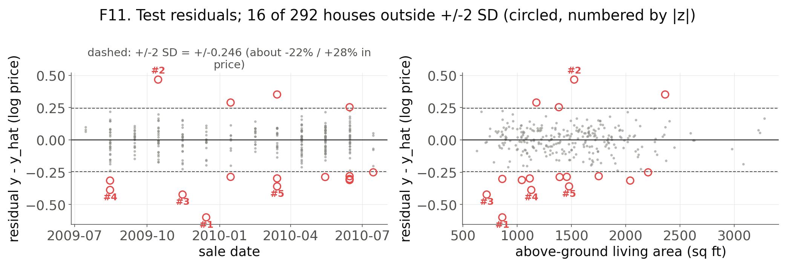
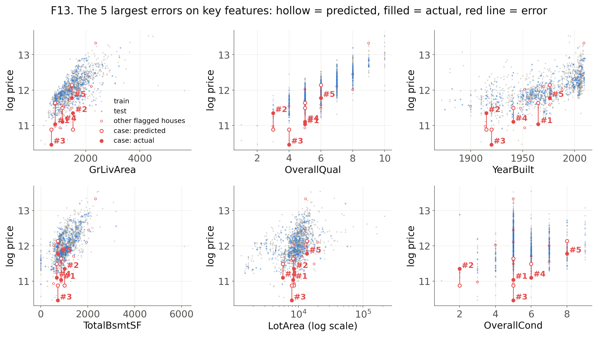
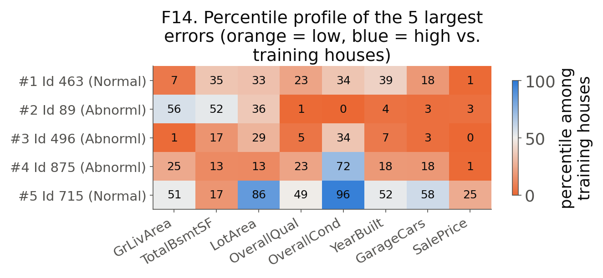

**Shared pattern.**
- **Mostly missing information, not model failure.** Comparable-sales verdicts over all 16 flagged houses: missing information × 7, model error × 5, atypical house × 2, price noise × 2. In most cases similar houses sold near the model's prediction, so the price was set by something the data does not record.
- **Abnormal sales dominate.** Non-Normal sales are 56% of the flagged houses vs. 14% of the test set (F12); the forced-sale discount is invisible in the features.
- **Older, lower-quality, cheaper houses.** Flagged houses are older and in worse condition than the rest (T22, F13–F14). At the low end the training data are sparse, so prices beyond the training range are extrapolated.
- **Model errors.** The *model error* cases (#2, #5, #11, #14, #16) are sales whose comparables agree with the actual price; they point to coefficient trade-offs inside the collinear area / quality / condition blocks.

**First fix to try:** model non-Normal sales separately or add SaleCondition x size / quality interactions.

| Feature | Flagged mean | Other test houses | SMD |
|:---|---:|---:|---:|
| GrLivArea | 1,407.7 | 1,485.1 | **-0.16** |
| TotalBsmtSF | 1,086.4 | 1,047.1 | +0.08 |
| LotArea | 10,771.4 | 9,936.2 | **+0.18** |
| OverallQual | 5.6 | 6.0 | **-0.30** |
| OverallCond | 5.2 | 5.6 | **-0.33** |
| YearBuilt | 1,955.7 | 1,970.3 | **-0.47** |
| SalePrice ($) | 143,593.9 | 177,239.9 | **-0.31** |

*Table 22: Flagged vs. other test houses (raw units; |SMD| > 0.1 = a real difference).*

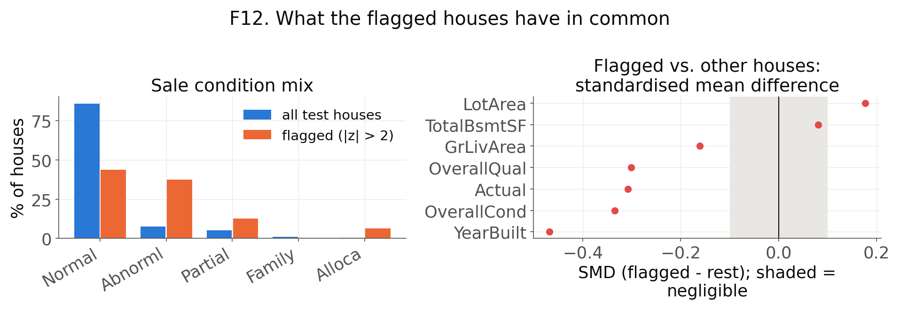

## 10. Evaluation standards used and why

| Standard | Section | Why |
|:---|:---|:---|
| Time-series CV only, fold-only preprocessing | §1, §4 | features include time; validation rows must not inform training |
| MAE in $ with a decision threshold; RMSE, MAPE, R², within ±10% | §5 | the user's cost in dollars plus relative and explained-variance views |
| Baselines of increasing strength under the same protocol | §5, §6 | shows what the features and the model add |
| Corrected t (folds) + paired bootstrap / Wilcoxon (test) vs. the strongest baseline | §6 | whether the gap exceeds chance |
| Mean-residual t-test, Breusch-Pagan, Durbin-Watson | §6 | level shift between periods; justify bootstrap intervals |
| Bootstrap CI / p, selection frequency, VIF / GVIF | §8 | valid inference for a penalised model; stability; collinearity |
| Holm correction | §7 | 15 pairwise ablation comparisons |
| Comparable sales + rule-based causes | §9 | separate missing information from model error |

## 11. Limitations

- Hyperparameters are chosen on the same CV that reports the tuning score (no nested CV); the test set is the unbiased estimate.
- The 10% decision threshold is an assumption about the user, not a measured cost.
- Greedy feature lists were selected on the whole training set, so CV scores of Sets E and F are optimistic.
- Bootstrap p-values after penalised selection are approximate.
- Comparable-sales verdicts use 10 neighbours on 7 features; they are a diagnostic, not a valuation.

## References

- Ambroise, C., & McLachlan, G. J. (2002). Selection bias in gene extraction on the basis of microarray gene-expression data. *PNAS*, 99(10), 6562-6566.
- Bergmeir, C., & Benítez, J. M. (2012). On the use of cross-validation for time series predictor evaluation. *Information Sciences*, 191, 192-213.
- Bergstra, J., & Bengio, Y. (2012). Random search for hyper-parameter optimization. *Journal of Machine Learning Research*, 13, 281-305.
- Breusch, T. S., & Pagan, A. R. (1979). A simple test for heteroscedasticity and random coefficient variation. *Econometrica*, 47(5), 1287-1294.
- Cohen, J. (1988). *Statistical Power Analysis for the Behavioral Sciences* (2nd ed.). Erlbaum.
- De Cock, D. (2011). Ames, Iowa: Alternative to the Boston housing data as an end of semester regression project. *Journal of Statistics Education*, 19(3).
- Durbin, J., & Watson, G. S. (1950). Testing for serial correlation in least squares regression I. *Biometrika*, 37(3/4), 409-428.
- Efron, B., & Tibshirani, R. J. (1993). *An Introduction to the Bootstrap*. Chapman & Hall.
- Fox, J., & Monette, G. (1992). Generalized collinearity diagnostics. *Journal of the American Statistical Association*, 87(417), 178-183.
- Friedman, J., Hastie, T., & Tibshirani, R. (2010). Regularization paths for generalized linear models via coordinate descent. *Journal of Statistical Software*, 33(1), 1-22.
- Hastie, T., Tibshirani, R., & Friedman, J. (2009). *The Elements of Statistical Learning* (2nd ed.). Springer.
- Hoerl, A. E., & Kennard, R. W. (1970). Ridge regression: biased estimation for nonorthogonal problems. *Technometrics*, 12(1), 55-67.
- Holm, S. (1979). A simple sequentially rejective multiple test procedure. *Scandinavian Journal of Statistics*, 6(2), 65-70.
- Huber, P. J. (1981). *Robust Statistics*. Wiley.
- Hyndman, R. J., & Athanasopoulos, G. (2021). *Forecasting: Principles and Practice* (3rd ed.). OTexts.
- Kaufman, S., Rosset, S., Perlich, C., & Stitelman, O. (2012). Leakage in data mining: formulation, detection, and avoidance. *ACM TKDD*, 6(4), 15.
- Meinshausen, N., & Bühlmann, P. (2010). Stability selection. *Journal of the Royal Statistical Society B*, 72(4), 417-473.
- Nadeau, C., & Bengio, Y. (2003). Inference for the generalization error. *Machine Learning*, 52(3), 239-281.
- O'Brien, R. M. (2007). A caution regarding rules of thumb for variance inflation factors. *Quality & Quantity*, 41, 673-690.
- Pagourtzi, E., Assimakopoulos, V., Hatzichristos, T., & French, N. (2003). Real estate appraisal: a review of valuation methods. *Journal of Property Investment & Finance*, 21(4), 383-401.
- Tibshirani, R. (1996). Regression shrinkage and selection via the lasso. *Journal of the Royal Statistical Society B*, 58(1), 267-288.
- Wasserstein, R. L., & Lazar, N. A. (2016). The ASA statement on p-values: context, process, and purpose. *The American Statistician*, 70(2), 129-133.
- Wilcoxon, F. (1945). Individual comparisons by ranking methods. *Biometrics Bulletin*, 1(6), 80-83.
- Zou, H., & Hastie, T. (2005). Regularization and variable selection via the elastic net. *Journal of the Royal Statistical Society B*, 67(2), 301-320.
